# Book Pipeline — dữ liệu sách Hardcover cho phân tích và RAG

Dự án lấy dữ liệu sách từ API GraphQL của [Hardcover](https://hardcover.app), lưu dữ liệu thô vào MinIO, chuẩn hóa bằng PySpark và tạo các bảng phục vụ phân tích bằng dbt + DuckDB. Một nhánh riêng đưa nội dung sách sang PostgreSQL có `pgvector` để tìm kiếm ngữ nghĩa và làm nền cho ứng dụng Streamlit.

> **Trạng thái 15/10/2026:** pipeline dữ liệu và chatbot local đã có baseline chạy được. SQL lookup/filter trả metadata theo template; semantic/mixed gọi Ollama và có thể từ chối khi thiếu evidence. Verifier kiểm tra citation ID, chưa kiểm chứng từng nhận định. Dashboard và vận hành production còn để phát triển sau.

## Dự án giải quyết việc gì?

Hardcover cung cấp dữ liệu phong phú nhưng ở dạng API. Dự án biến dữ liệu đó thành hai đầu ra dễ dùng:

- **Kho dữ liệu phân tích:** các bảng Gold trong DuckDB, phù hợp cho SQL, dashboard và khám phá dữ liệu.
- **Nền RAG:** tài liệu được chuẩn bị từ Gold, tạo embedding và lưu trong PostgreSQL `pgvector` để retriever tìm sách liên quan.

Gold **không nằm trong PostgreSQL**. Gold là file DuckDB do dbt tạo. PostgreSQL là kho vector riêng cho nhánh RAG.

## Kiến trúc

```mermaid
flowchart LR
    accTitle: Kiến trúc Book Pipeline từ Hardcover đến phân tích và RAG
    accDescr: Dữ liệu đi từ Hardcover GraphQL vào MinIO Bronze dạng JSONL, qua PySpark thành Silver Parquet, rồi qua dbt và DuckDB thành Gold. Một nhánh riêng lập chỉ mục trong PostgreSQL pgvector để retriever và ứng dụng Streamlit sử dụng. Airflow hiện điều phối các tác vụ ingestion.

    HC[Hardcover GraphQL API] --> ING[Python ingestion<br/>phân trang + checkpoint]
    ING --> BR[(MinIO Bronze<br/>JSONL)]
    BR --> SP[PySpark<br/>làm phẳng + chuẩn hóa]
    SP --> SI[(MinIO Silver<br/>Parquet)]
    SI --> DBT[dbt + DuckDB<br/>business logic + kiểm thử]
    DBT --> GO[(Gold<br/>gold.duckdb)]
    GO --> IDX[Embedding + lập chỉ mục]
    IDX --> PG[(PostgreSQL<br/>pgvector)]
    PG --> RET[Retriever]
    RET --> UI[Streamlit<br/>đang phát triển]
    AF[Apache Airflow] -. điều phối ingestion .-> ING
```



### Vai trò từng tầng

| Tầng | Công nghệ | Nội dung |
|---|---|---|
| Nguồn | Hardcover GraphQL | Sách, tác giả, ấn bản, bộ sách, thẻ, nhà xuất bản và bảng tham chiếu |
| Bronze | MinIO, JSONL | Dữ liệu gần nguyên bản; ghi theo batch để có thể tiếp tục sau gián đoạn |
| Silver | PySpark, Parquet | Làm phẳng cấu trúc, ép kiểu, loại bản trùng và tách bảng quan hệ |
| Gold | dbt, DuckDB | Mô hình phân tích như `dim_books`, `dim_authors`, `dim_editions`, `dim_tags`, bridge và fact |
| Vector index | PostgreSQL, pgvector | Kho embedding riêng, được xây từ dữ liệu Gold |
| Phục vụ | Retriever, Streamlit | Tìm kiếm ngữ nghĩa và giao diện người dùng; đang phát triển |
| Điều phối | Airflow | DAG full, daily và weekly cho ingestion; chưa nối tự động toàn bộ transform/RAG |

## Trạng thái triển khai

### Done

- Hardcover GraphQL client, retry và phân trang.
- Ingestion cho `books`, `authors`, `editions`, `series`, `tags`, `publishers`, `countries`, `languages`, `reading_formats`; `platforms` là tùy chọn.
- Checkpoint/resume, full fetch và incremental fetch cho entity có `updated_at`.
- Upload từng batch JSONL vào `bronze/<entity>/` trên MinIO.
- PySpark Bronze → Silver, ghi Parquet vào `silver/<table>/`.
- dbt + DuckDB Silver → Gold cùng schema tests và data test.
- Docker Compose cho MinIO, PostgreSQL metadata của Airflow, PostgreSQL `pgvector`, Airflow webserver và scheduler.
- Ba DAG ingestion: full thủ công, daily và weekly.

### In progress

- Retriever SQL/vector/mixed, context builder, Ollama generator, citation verifier và Streamlit chatbot đã có baseline local được kiểm tra.
- Indexer đọc `rag_documents`, mặc định 10.000 sách; collection hiện có 39.604 chunks.
- Có bộ 40 câu dev với ID/nhãn dựa trên Gold để đo Recall@k, MRR@k và hit rate; nhãn ngữ nghĩa còn một phần, chưa được người dùng duyệt hoặc giữ riêng để test.
- `src/serve/dashboard.py` còn trống; incremental/versioned index và claim-level verification chưa triển khai.

### Planned

- Mở rộng lexical/RRF và local graph thử nghiệm ra corpus đầy đủ; nhãn relevance được người dùng duyệt và kiểm chứng từng nhận định.
- Index có phiên bản và cập nhật tăng dần.
- Mở rộng Airflow từ ingestion sang Bronze → Silver → Gold → vector index.
- Thêm quan sát chất lượng dữ liệu và vận hành production.

## Quick start — Windows CMD

### Yêu cầu

- Python 3.10 trở lên
- Docker Desktop có Docker Compose
- Java tương thích với PySpark
- Hardcover API key lấy tại <https://hardcover.app/account/api>

Các lệnh dưới đây dành cho **Command Prompt (CMD)**, chạy tại thư mục gốc repository.

### 1. Tạo môi trường Python

```bat
python -m venv .venv
.venv\Scripts\activate
python -m pip install --upgrade pip
python -m pip install -e ".[ingestion,transform,dev]"
copy .env.example .env
```

Mở `.env`, thay `HARDCOVER_API_KEY`. Khi chạy Python trên máy host, đặt:

```env
MINIO_ENDPOINT=localhost:9000
```

Không commit token hoặc mật khẩu thật.

### 2. Khởi động hạ tầng local

```bat
docker compose up -d minio postgres-vector postgres airflow-init airflow-webserver airflow-scheduler
```

Các địa chỉ mặc định:

- MinIO API: <http://localhost:9000>
- MinIO Console: <http://localhost:9001>
- Airflow: <http://localhost:8080> — tài khoản dev mặc định `admin` / `admin`
- pgvector: `localhost:5433`

Mật khẩu mặc định chỉ phù hợp môi trường local. Đổi secrets trong `.env` trước khi đưa máy ra mạng.

### 3. Fetch dữ liệu vào Bronze

Kiểm tra entity hỗ trợ:

```bat
set PYTHONPATH=src
python -m ingestion list-entities
```

Chạy thử một entity:

```bat
set PYTHONPATH=src
python -m ingestion fetch --entity books --mode full --batch-size 100 --checkpoint-dir checkpoints
```

Hoặc vào Airflow, bật và trigger `hardcover_ingestion_full`. Sau lần full thành công, bật `hardcover_ingestion_daily` và `hardcover_ingestion_weekly` nếu cần đồng bộ định kỳ.

> Full fetch có thể lớn và mất nhiều giờ. Checkpoint cho phép chạy lại để tiếp tục.

### 4. Chuyển Bronze thành Silver

```bat
set PYTHONPATH=src
python -m transform.bronze_to_silver.run_books
python -m transform.bronze_to_silver.run_authors
python -m transform.bronze_to_silver.run_editions
python -m transform.bronze_to_silver.run_dimensions
```

PySpark đọc `s3a://hardcover-lake/bronze/...` và ghi Parquet vào `s3a://hardcover-lake/silver/...`.

### 5. Tạo Gold bằng dbt + DuckDB

Từ thư mục gốc:

```bat
cd src\transform\silver_to_gold
dbt run --profiles-dir .
dbt test --profiles-dir .
cd ..\..\..
```

Mặc định DuckDB Gold được tạo theo `DUCKDB_PATH` trong profile, với giá trị mặc định tương đối là `data/warehouse/gold.duckdb`. Vì đường dẫn tương đối phụ thuộc thư mục chạy dbt, nên đặt đường dẫn tuyệt đối khi cần vị trí ổn định:

```bat
set DUCKDB_PATH=D:/lap_trinh/my_project/book-pipeline/data/warehouse/gold.duckdb
```

### 6. Chạy kiểm thử Python

```bat
python -m pytest -q
```

### Nhánh RAG và Streamlit

**Tích hợp tiếng Việt:** các câu tự nhiên/không dấu hiện đi qua Ollama tạo QueryPlan có schema → LangChain SelfQueryRetriever → pgvector. Tên sách/tác giả rõ giữ SQL. Các giới hạn số rõ được đối chiếu bằng code; câu mơ hồ trả `CLARIFY`. Đặt `QUERY_MODEL` nếu muốn đổi model hiểu câu hỏi (độc lập với model viết đáp án trong sidebar). Bộ phát triển 12 câu đã được kiểm tra, chưa phải đánh giá ngôn ngữ tổng quát.

Walkthrough mới: `docs/WALKTHROUGH_SELF_QUERY_INTEGRATION.md`; chạy kiểm tra tích hợp bằng `python scripts/evaluate_integrated_vietnamese.py`.

Máy hiện tại dùng Conda environment `aiEnv`. Với môi trường mới, tạo environment Python phù hợp trước, rồi cài extras:

```bat
conda activate aiEnv
cd /d D:\lap_trinh\my_project\book-pipeline
python -m pip install -e ".[ingestion,serve,dev]"
docker compose up -d minio postgres-vector
ollama list
python -m pytest -q
python -m ruff check src tests scripts
python -m streamlit run src/serve/chatbot.py
```

Ollama cần chạy và có model đã chọn trong sidebar. SQL answers không cần LLM; semantic/mixed dùng LLM. Gold DuckDB và vector collection phải đã tồn tại; clone source không mang theo dữ liệu runtime.

```bat
python tests/eval_retriever.py
python scripts/smoke_rag.py
python -m scripts.evaluate_relevance
```

Relevance report lưu tại `data/reports/relevance_baseline.json` và `.md`, tách điểm theo loại câu/ngôn ngữ, lỗi dịch vụ và kiểm tra hash nhãn. `tests/relevance_dataset.json` là dữ liệu đánh giá; chatbot chỉ nhận câu hỏi, không nhận đáp án chuẩn. Giữ dataset cố định khi so kết quả; chỉ chạy `python -m scripts.build_relevance_dataset` sau khi review thay đổi Gold. SQL và vector hiện có corpus khác nhau, chưa dùng báo cáo này để khẳng định thuật toán nào tốt hơn.

Smoke report lưu ở `data/reports/rag_smoke.json`. Nó kiểm tra luồng dịch vụ và trạng thái an toàn, không chứng minh semantic relevance hoặc factual correctness. Semantic/mixed có thể ABSTAIN dù retriever tìm được sách.

Test offline/CI: `python -m pytest -q -m "not integration"`. Test integration cần Gold, pgvector và embedding model. Nếu model đã có cache, có thể dùng `set HF_HUB_OFFLINE=1` để tránh gọi Hugging Face khi khởi động.

**Reranker tùy chọn:** đã tích hợp cross-encoder CPU, nhận English semantic query sau bước hiểu câu Việt. Đặt `RAG_RERANK_ENABLED=1` trước khi mở app để bật; mặc định 0. Chỉ xếp lại ứng viên đã lọc, giữ metadata/evidence, bỏ qua SQL và tra tên sách. Model lỗi thì quay về thứ tự retrieval có ghi trạng thái fallback. Chạy `python -m scripts.benchmark_reranking` để so trên cùng candidate pool. Trong bộ 40 câu dev hiện tại, reranker giữ nguyên hit rate/MRR và thêm khoảng nửa giây cho mỗi câu được rerank, nên chưa bật mặc định.

**Hybrid/GraphRAG thử nghiệm:** đã có BM25+dense qua RRF và local graph+dense trên artifact 300 sách. Dựng bằng `python -m scripts.build_search_experiment`, so bằng `python -m scripts.compare_search_strategies`. Trong sidebar chọn **Cách tìm sách** để thử; mặc định giữ baseline. Xem [hướng dẫn và giới hạn](tests/SEARCH_EXPERIMENT.md). Chưa có community/global search của Microsoft GraphRAG; dữ liệu graph/lexical không thay thế full index hiện có.

`build_index.py` xóa collection trước khi rebuild; chỉ chạy khi chủ động cần dựng lại. Walkthrough và các bài tự code nâng cấp nằm tại `docs/WALKTHROUGH_2026-10-15.md` và `docs/learning/README.md` (thư mục docs hiện bị Git ignore).

## Cấu trúc repository

```text
book-pipeline/
├── config/
│   └── entities.yaml                   # cấu hình entity ingestion
├── docs/
│   ├── papers/                         # paper nghiên cứu và mục lục
│   ├── LEARNING_ROADMAP.md
│   └── MIGRATE_FROM_OLD_VERSION.md
├── notebooks/
│   └── eda.ipynb
├── scripts/                            # hiện chưa có script chính thức
├── src/
│   ├── clients/
│   │   ├── hardcover.py                # Hardcover GraphQL client
│   │   └── minio.py                    # MinIO client
│   ├── ingestion/
│   │   ├── cli.py                      # CLI và run_fetch
│   │   └── fetchers/                   # fetcher theo entity
│   ├── orchestrate/dags/
│   │   ├── hardcover_ingestion_full.py
│   │   ├── hardcover_ingestion_daily.py
│   │   └── hardcover_ingestion_weekly.py
│   ├── transform/
│   │   ├── bronze_to_silver/           # PySpark jobs
│   │   └── silver_to_gold/             # dbt project + DuckDB profile
│   └── serve/
│       ├── rag/
│       │   ├── build_index.py
│       │   └── retriever.py
│       ├── chatbot.py                  # placeholder
│       └── dashboard.py                # placeholder
├── tests/
│   ├── clients/
│   ├── contracts/
│   └── ingestion/
├── Dockerfile.airflow
├── docker-compose.yml
├── Makefile                            # tiện cho shell có make; CMD dùng lệnh trực tiếp ở trên
├── pyproject.toml
└── requirements.txt                    # dependency image Airflow/ingestion
```

Các thư mục runtime như `checkpoints/`, `logs/`, `plugins/` hoặc `data/warehouse/` có thể xuất hiện sau khi chạy; chúng không phải source tree hiện có.

## Ghi chú vận hành

- Airflow hiện chỉ điều phối ingestion, không nên hiểu là đã điều phối toàn bộ pipeline.
- `postgres` trong Compose là metadata DB của Airflow; `postgres-vector` là DB riêng cho RAG.
- Silver và Bronze nằm trên MinIO; Gold nằm trong DuckDB.
- Cấu hình Compose dùng credential dễ nhớ cho local development. Không dùng nguyên trạng cho môi trường public hoặc production.
