# Book Pipeline — dữ liệu sách Hardcover cho phân tích và RAG

Dự án lấy dữ liệu sách từ API GraphQL của [Hardcover](https://hardcover.app), lưu dữ liệu thô vào MinIO, chuẩn hóa bằng PySpark và tạo các bảng phục vụ phân tích bằng dbt + DuckDB. Một nhánh riêng đưa nội dung sách sang PostgreSQL có `pgvector` để tìm kiếm ngữ nghĩa và làm nền cho ứng dụng Streamlit.

> **Trạng thái:** pipeline dữ liệu Bronze → Silver → Gold đã có mã nguồn và artefact chạy thành công trong repository. Nhánh RAG và giao diện Streamlit vẫn đang phát triển; chưa nên xem là ứng dụng hoàn chỉnh.

## Dự án giải quyết việc gì?

Hardcover cung cấp dữ liệu phong phú nhưng ở dạng API. Dự án biến dữ liệu đó thành hai đầu ra dễ dùng:

- **Kho dữ liệu phân tích:** các bảng Gold trong DuckDB, phù hợp cho SQL, dashboard và khám phá dữ liệu.
- **Nền RAG:** tài liệu được chuẩn bị từ Gold, tạo embedding và lưu trong PostgreSQL `pgvector` để retriever tìm sách liên quan.

Gold **không nằm trong PostgreSQL**. Gold là file DuckDB do dbt tạo. PostgreSQL là kho vector riêng cho nhánh RAG.

## Kiến trúc

```mermaid
flowchart LR
    accTitle: Kiến trúc Book Pipeline từ Hardcover đến phân tích và RAG
    accDescr: Dữ liệu đi từ Hardcover GraphQL vào MinIO Bronze dạng JSONL, qua PySpark thành Silver Parquet, rồi qua dbt và DuckDB thành Gold. Một nhánh riêng lập chỉ mục trong PostgreSQL pgvector để retriever và ứng dụng Streamlit sử dụng. Airflow hiện điều phối các tác vụ ingestion.

    HC[Hardcover GraphQL API] --> ING[Python ingestion<br/>phân trang + checkpoint]
    ING --> BR[(MinIO Bronze<br/>JSONL)]
    BR --> SP[PySpark<br/>làm phẳng + chuẩn hóa]
    SP --> SI[(MinIO Silver<br/>Parquet)]
    SI --> DBT[dbt + DuckDB<br/>business logic + kiểm thử]
    DBT --> GO[(Gold<br/>gold.duckdb)]
    GO --> IDX[Embedding + lập chỉ mục]
    IDX --> PG[(PostgreSQL<br/>pgvector)]
    PG --> RET[Retriever]
    RET --> UI[Streamlit<br/>đang phát triển]
    AF[Apache Airflow] -. điều phối ingestion .-> ING
```



### Vai trò từng tầng

| Tầng | Công nghệ | Nội dung |
|---|---|---|
| Nguồn | Hardcover GraphQL | Sách, tác giả, ấn bản, bộ sách, thẻ, nhà xuất bản và bảng tham chiếu |
| Bronze | MinIO, JSONL | Dữ liệu gần nguyên bản; ghi theo batch để có thể tiếp tục sau gián đoạn |
| Silver | PySpark, Parquet | Làm phẳng cấu trúc, ép kiểu, loại bản trùng và tách bảng quan hệ |
| Gold | dbt, DuckDB | Mô hình phân tích như `dim_books`, `dim_authors`, `dim_editions`, `dim_tags`, bridge và fact |
| Vector index | PostgreSQL, pgvector | Kho embedding riêng, được xây từ dữ liệu Gold |
| Phục vụ | Retriever, Streamlit | Tìm kiếm ngữ nghĩa và giao diện người dùng; đang phát triển |
| Điều phối | Airflow | DAG full, daily và weekly cho ingestion; chưa nối tự động toàn bộ transform/RAG |

## Trạng thái triển khai

### Done

- Hardcover GraphQL client, retry và phân trang.
- Ingestion cho `books`, `authors`, `editions`, `series`, `tags`, `publishers`, `countries`, `languages`, `reading_formats`; `platforms` là tùy chọn.
- Checkpoint/resume, full fetch và incremental fetch cho entity có `updated_at`.
- Upload từng batch JSONL vào `bronze/<entity>/` trên MinIO.
- PySpark Bronze → Silver, ghi Parquet vào `silver/<table>/`.
- dbt + DuckDB Silver → Gold cùng schema tests và data test.
- Docker Compose cho MinIO, PostgreSQL metadata của Airflow, PostgreSQL `pgvector`, Airflow webserver và scheduler.
- Ba DAG ingestion: full thủ công, daily và weekly.

### In progress

- Script tạo pgvector index từ `dim_books` đã có, nhưng dependency RAG chưa được khai báo đầy đủ trong `pyproject.toml`/`requirements.txt` và chưa có bằng chứng chạy end-to-end trong repository.
- Retriever mới ở mức khởi tạo vector store; hiện còn lỗi import/thiếu luồng truy vấn hoàn chỉnh.
- Streamlit: `src/serve/chatbot.py` và `src/serve/dashboard.py` chưa có ứng dụng chạy được.

### Planned

- Hoàn thiện retriever, trả lời có nguồn và giao diện Streamlit.
- Bổ sung dependency, cấu hình và kiểm thử end-to-end cho nhánh RAG.
- Mở rộng Airflow từ ingestion sang Bronze → Silver → Gold → vector index.
- Thêm quan sát chất lượng dữ liệu và vận hành production.

## Quick start — Windows CMD

### Yêu cầu

- Python 3.10 trở lên
- Docker Desktop có Docker Compose
- Java tương thích với PySpark
- Hardcover API key lấy tại <https://hardcover.app/account/api>

Các lệnh dưới đây dành cho **Command Prompt (CMD)**, chạy tại thư mục gốc repository.

### 1. Tạo môi trường Python

```bat
python -m venv .venv
.venv\Scripts\activate
python -m pip install --upgrade pip
python -m pip install -e ".[ingestion,transform,dev]"
copy .env.example .env
```

Mở `.env`, thay `HARDCOVER_API_KEY`. Khi chạy Python trên máy host, đặt:

```env
MINIO_ENDPOINT=localhost:9000
```

Không commit token hoặc mật khẩu thật.

### 2. Khởi động hạ tầng local

```bat
docker compose up -d minio postgres-vector postgres airflow-init airflow-webserver airflow-scheduler
```

Các địa chỉ mặc định:

- MinIO API: <http://localhost:9000>
- MinIO Console: <http://localhost:9001>
- Airflow: <http://localhost:8080> — tài khoản dev mặc định `admin` / `admin`
- pgvector: `localhost:5433`

Mật khẩu mặc định chỉ phù hợp môi trường local. Đổi secrets trong `.env` trước khi đưa máy ra mạng.

### 3. Fetch dữ liệu vào Bronze

Kiểm tra entity hỗ trợ:

```bat
set PYTHONPATH=src
python -m ingestion list-entities
```

Chạy thử một entity:

```bat
set PYTHONPATH=src
python -m ingestion fetch --entity books --mode full --batch-size 100 --checkpoint-dir checkpoints
```

Hoặc vào Airflow, bật và trigger `hardcover_ingestion_full`. Sau lần full thành công, bật `hardcover_ingestion_daily` và `hardcover_ingestion_weekly` nếu cần đồng bộ định kỳ.

> Full fetch có thể lớn và mất nhiều giờ. Checkpoint cho phép chạy lại để tiếp tục.

### 4. Chuyển Bronze thành Silver

```bat
set PYTHONPATH=src
python -m transform.bronze_to_silver.run_books
python -m transform.bronze_to_silver.run_authors
python -m transform.bronze_to_silver.run_editions
python -m transform.bronze_to_silver.run_dimensions
```

PySpark đọc `s3a://hardcover-lake/bronze/...` và ghi Parquet vào `s3a://hardcover-lake/silver/...`.

### 5. Tạo Gold bằng dbt + DuckDB

Từ thư mục gốc:

```bat
cd src\transform\silver_to_gold
dbt run --profiles-dir .
dbt test --profiles-dir .
cd ..\..\..
```

Mặc định DuckDB Gold được tạo theo `DUCKDB_PATH` trong profile, với giá trị mặc định tương đối là `data/warehouse/gold.duckdb`. Vì đường dẫn tương đối phụ thuộc thư mục chạy dbt, nên đặt đường dẫn tuyệt đối khi cần vị trí ổn định:

```bat
set DUCKDB_PATH=D:/lap_trinh/my_project/book-pipeline/data/warehouse/gold.duckdb
```

### 6. Chạy kiểm thử Python

```bat
python -m pytest -q
```

### Nhánh RAG và Streamlit

Chưa có quick start bảo đảm chạy end-to-end. `src/serve/rag/build_index.py` thể hiện hướng triển khai Gold DuckDB → embedding → PostgreSQL `pgvector`, nhưng dependency và retriever còn cần hoàn thiện. Streamlit vẫn đang phát triển.

## Cấu trúc repository

```text
book-pipeline/
├── config/
│   └── entities.yaml                   # cấu hình entity ingestion
├── docs/
│   ├── papers/                         # paper nghiên cứu và mục lục
│   ├── LEARNING_ROADMAP.md
│   └── MIGRATE_FROM_OLD_VERSION.md
├── notebooks/
│   └── eda.ipynb
├── scripts/                            # hiện chưa có script chính thức
├── src/
│   ├── clients/
│   │   ├── hardcover.py                # Hardcover GraphQL client
│   │   └── minio.py                    # MinIO client
│   ├── ingestion/
│   │   ├── cli.py                      # CLI và run_fetch
│   │   └── fetchers/                   # fetcher theo entity
│   ├── orchestrate/dags/
│   │   ├── hardcover_ingestion_full.py
│   │   ├── hardcover_ingestion_daily.py
│   │   └── hardcover_ingestion_weekly.py
│   ├── transform/
│   │   ├── bronze_to_silver/           # PySpark jobs
│   │   └── silver_to_gold/             # dbt project + DuckDB profile
│   └── serve/
│       ├── rag/
│       │   ├── build_index.py
│       │   └── retriever.py
│       ├── chatbot.py                  # placeholder
│       └── dashboard.py                # placeholder
├── tests/
│   ├── clients/
│   ├── contracts/
│   └── ingestion/
├── Dockerfile.airflow
├── docker-compose.yml
├── Makefile                            # tiện cho shell có make; CMD dùng lệnh trực tiếp ở trên
├── pyproject.toml
└── requirements.txt                    # dependency image Airflow/ingestion
```

Các thư mục runtime như `checkpoints/`, `logs/`, `plugins/` hoặc `data/warehouse/` có thể xuất hiện sau khi chạy; chúng không phải source tree hiện có.

## Tài liệu RAG

Các đường dẫn tài liệu định hướng của dự án:

- [Kiến trúc RAG](docs/RAG_ARCHITECTURE.md)
- [Hướng dẫn triển khai RAG](docs/RAG_IMPLEMENTATION_GUIDE.md)
- [Báo cáo nghiên cứu RAG](docs/RAG_RESEARCH_REPORT.md)
- [Danh mục papers](docs/papers/README.md)

> Lưu ý: tại trạng thái repository được kiểm tra, ba file RAG đầu chưa hiện diện; liên kết được giữ làm điểm đến tài liệu dự kiến. `docs/papers/README.md` đã có.

## Ghi chú vận hành

- Airflow hiện chỉ điều phối ingestion, không nên hiểu là đã điều phối toàn bộ pipeline.
- `postgres` trong Compose là metadata DB của Airflow; `postgres-vector` là DB riêng cho RAG.
- Silver và Bronze nằm trên MinIO; Gold nằm trong DuckDB.
- Cấu hình Compose dùng credential dễ nhớ cho local development. Không dùng nguyên trạng cho môi trường public hoặc production.
