# Kế hoạch bàn giao AI: hoàn thiện chatbot RAG gợi ý sách

> Tài liệu này là nguồn ngữ cảnh vận hành cho AI model tiếp theo. Đọc toàn bộ trước khi sửa code. Không bắt đầu Streamlit hay generation trước khi retrieval baseline được kiểm thử.

## 🎯 Mục tiêu sản phẩm

Xây chatbot gợi ý sách dựa trên kho Gold thật, có thể phát triển thành product:

- truy vấn chính xác bằng SQL cho rating, số trang, năm, genre và bộ lọc cứng;
- semantic retrieval cho theme, mood, atmosphere và mô tả tự nhiên;
- mixed retrieval cho yêu cầu vừa định lượng vừa ngữ nghĩa;
- citation truy ngược `book_id`, `document_hash`, `chunk_index`;
- từ chối khi không đủ evidence hoặc constraint không thể thỏa mãn;
- đánh giá bằng metric trước khi thêm thành phần phức tạp.

Phương pháp mục tiêu: **Selective Deterministic-First Evidence-Grounded RAG**. SQL đi trước khi câu hỏi có điều kiện structured; vector search chỉ đảm nhiệm semantic meaning; generator không được tự sửa hoặc bỏ constraint.

## 📍 Trạng thái hiện tại

### Đã hoàn thành

- Pipeline Hardcover API → MinIO Bronze → PySpark Silver → dbt/DuckDB Gold.
- `dim_books` và `rag_documents` đã build thành công.
- 19 dbt tests pass: `PASS=19 WARN=0 ERROR=0`.
- Post-build data checks pass.
- `dim_books`: 2,536,241 rows.
- `rag_documents`: 2,536,241 rows.
- Embedding candidates: 950,470 rows.
- HTML tags/entities, invalid clean pages/year, candidate contract violations: đều 0.
- PostgreSQL pgvector service riêng đang chạy trên host port `5433`.
- `build_index.py` đã chuyển sang đọc `rag_documents`.
- Baseline index: 10,000 books → 39,604 chunks.
- Collection `books` có đúng 39,604 embedding rows.
- Semantic smoke test pass.

### Đang làm

Hoàn thiện online retrieval trong:

```text
src/serve/rag/retriever.py
```

File hiện chỉ có loader chưa hoàn chỉnh và có lỗi import/tên hàm. Chưa được xem là baseline chạy được.

### Chưa làm

- Query router hoàn chỉnh.
- SQL/vector/mixed public retrieval API.
- Retrieval test/evaluation set.
- Lexical full-text retrieval và RRF.
- Metadata reranking/diversity.
- Context builder, generator, citation verifier.
- Streamlit chatbot.
- Typed conversational memory.

## 🧭 Kiến trúc và thứ tự bắt buộc

```mermaid
flowchart LR
    accTitle: Book RAG Delivery Pipeline
    accDescr: Dữ liệu đi từ Hardcover qua Bronze, Silver và Gold trước khi được chunk, embed, retrieve, kiểm chứng và hiển thị trong chatbot.

    hardcover["Hardcover GraphQL API"] --> bronze["MinIO Bronze JSONL"]
    bronze --> silver["PySpark Silver Parquet"]
    silver --> gold["dbt DuckDB Gold"]
    gold --> contract["rag_documents contract"]
    contract --> indexer["build_index.py offline"]
    indexer --> pgvector["PostgreSQL pgvector"]
    question["User question"] --> retriever["retriever.py online"]
    pgvector --> retriever
    gold --> retriever
    retriever --> evaluation["Retrieval checks and metrics"]
    evaluation --> context["context_builder.py"]
    context --> generation["generator.py"]
    generation --> verifier["verifier.py"]
    verifier --> chatbot["Streamlit chatbot.py"]

    classDef data fill:#dbeafe,stroke:#2563eb,color:#1e3a5f
    classDef rag fill:#dcfce7,stroke:#16a34a,color:#14532d
    classDef gate fill:#fef9c3,stroke:#ca8a04,color:#713f12
    class bronze,silver,gold,contract,pgvector data
    class indexer,retriever,context,generation,verifier,chatbot rag
    class evaluation gate
```



Không đổi thứ tự:

1. Hoàn thiện retriever baseline.
2. Viết runnable retrieval checks.
3. Tạo evaluation set và đo baseline.
4. Chỉ sau đó thêm hybrid/RRF/reranking/diversity.
5. Chỉ sau retrieval ổn mới thêm generation/citation/verifier.
6. Streamlit sau cùng.
7. Memory sau single-turn baseline.

## 🗂️ File và trách nhiệm

| File | Trách nhiệm | Trạng thái |
|---|---|---|
| `src/transform/silver_to_gold/models/dim_books.sql` | Gold book dimension, clean fields, flags, metadata | Hoàn thành |
| `src/transform/silver_to_gold/models/rag_documents.sql` | Parent-document contract, hash, dedup, eligibility | Hoàn thành |
| `src/serve/rag/build_index.py` | Offline load, split, embed, batch insert pgvector | Baseline hoàn thành |
| `src/serve/rag/retriever.py` | Online route và search facade | Việc kế tiếp |
| `src/serve/rag/context_builder.py` | Gom evidence, dedup chunk, giữ provenance | Chưa tạo |
| `src/serve/rag/generator.py` | Citation-constrained answer generation | Chưa tạo |
| `src/serve/rag/verifier.py` | ACCEPT/REGENERATE/ABSTAIN | Chưa tạo |
| `src/serve/chatbot.py` | Streamlit UI, chỉ gọi public services | Chưa làm |
| `tests/` | Unit/integration/retrieval checks | Thiếu RAG tests |

Public facade mong muốn của retrieval:

```python
results = search(question, limit=5)
```

Các helper nội bộ:

```python
_load_vectorstore()
_vector_search()
_sql_search()
_route()
```

Prefix `_` chỉ là Python convention cho API nội bộ, không chặn import thật.

## 🧱 Data contract hiện có

### `dim_books`

Fields quan trọng:

```text
book_id, title, description, author_names, genres, moods, pace,
series_info, rating, ratings_count, pages, pages_clean,
release_year, release_year_clean, content_quality,
is_partial_book, compilation, chunk_text
```

Nguyên tắc:

- giữ raw field để audit;
- dùng clean field khi filter;
- không xóa whole book vì một field xấu;
- suspicious/quality flags giao downstream quyết định.

### `rag_documents`

Fields quan trọng:

```text
book_id, document_text, document_length, document_hash,
document_duplicate_rank, document_quality, is_embedding_candidate
```

Candidate contract:

```sql
document_quality = 'Rich'
and is_title_missing = false
and document_length >= 200
and document_duplicate_rank = 1
```

## 🧩 Offline indexing đã làm gì

`src/serve/rag/build_index.py`:

1. `_load_books(limit=10_000)` đọc embedding candidates từ DuckDB.
2. `_make_documents()` chia parent text bằng `RecursiveCharacterTextSplitter`.
3. Chunk size `500`, overlap `50`.
4. Gắn metadata gồm `book_id`, title, authors, genres, moods, series, rating, ratings count, clean pages/year, quality, document hash và chunk index.
5. `_build_index()` embed bằng `all-MiniLM-L6-v2`, normalize vector, CPU.
6. Insert batch `1_000`; batch là bắt buộc vì insert toàn bộ từng gây lỗi PostgreSQL giới hạn 65,535 parameters.
7. `pre_delete_collection=True` rebuild sạch collection `books`.

Giới hạn có chủ ý:

- Chỉ 10,000 books để baseline nhanh và reproducible.
- Đây chưa phải full production index.
- `pre_delete_collection=True` không an toàn cho zero-downtime production; sau này dùng versioned collection và atomic switch.
- `HuggingFaceEmbeddings` từ `langchain_community` đang deprecated nhưng vẫn chạy; chưa thêm package mới chỉ để xóa warning. Khi đồng bộ dependencies, cân nhắc `langchain-huggingface`.

## 🚦 Nhiệm vụ kế tiếp: hoàn thiện `retriever.py`

### Bước 0 — Đọc trước khi sửa

Đọc:

```text
src/serve/rag/retriever.py
src/serve/rag/build_index.py
src/transform/silver_to_gold/models/rag_documents.sql
src/transform/silver_to_gold/models/dim_books.sql
.env.example
pyproject.toml
```

Không in secret từ `.env` vào output hoặc commit.

### Bước 1 — Sửa imports và configuration

Lỗi hiện biết:

```python
from lanchain_comunity.embeddings import HuggingFaceEmbeddings
```

Phải thành:

```python
from langchain_community.embeddings import HuggingFaceEmbeddings
```

Đổi:

```python
def load_vetorstore()
```

thành:

```python
def _load_vectorstore()
```

Dùng defaults giống `build_index.py`, không để connection string tạo ra `None` nếu `.env` thiếu key.

Nên tránh load embedding model lại mỗi request. Baseline tối thiểu dùng `functools.lru_cache(maxsize=1)` trên `_load_vectorstore()` và có một helper cached cho embedding nếu cần.

### Bước 2 — Định nghĩa result contract trước

Không trả raw `Document` khắp app. Chọn dictionary ổn định, tối thiểu:

```python
{
    "book_id": "123",
    "title": "Dune",
    "author_names": "Frank Herbert",
    "evidence": "retrieved chunk",
    "score": 0.82,
    "source": "vector",
    "chunk_index": 2,
}
```

SQL result dùng cùng shape; field không có evidence chunk có thể dùng summary/description hoặc `None` có chủ ý.

### Bước 3 — `_vector_search(question, limit)`

Yêu cầu:

- validate `question.strip()` và `limit >= 1`;
- gọi cached vectorstore;
- dùng cosine-compatible search;
- hiểu rõ API trả **distance** hay relevance score trước khi đặt tên `score`;
- chuyển raw LangChain result sang result contract;
- deduplicate theo `book_id`, vì nhiều chunk của cùng sách có thể cùng top-k;
- lấy nhiều chunks hơn số books cần, ví dụ `fetch_k = limit * 4`, rồi giữ best chunk mỗi book;
- không đặt threshold tùy ý trước evaluation.

Quan trọng: `similarity_search_with_score()` trong baseline smoke test trả distance nhỏ hơn là gần hơn. Không được hiển thị distance đó như confidence lớn hơn là tốt hơn. Hoặc đổi thành relevance score API đã kiểm chứng, hoặc giữ field tên `distance`.

### Bước 4 — `_sql_search(question, limit)`

Baseline deterministic parser chỉ cần hỗ trợ rõ ràng:

- rating tối thiểu/tối đa;
- pages tối đa/tối thiểu;
- release year/range;
- genre exact/contains;
- title/author exact lookup khi có pattern rõ.

Bắt buộc:

- parameterized SQL; không f-string user text vào câu SQL;
- dùng `pages_clean`, `release_year_clean`;
- stable order, ví dụ rating rồi ratings count rồi `book_id`;
- hard constraints không được âm thầm bỏ;
- result rỗng phải trả rỗng cùng reason, không tự fallback semantic nếu constraint rõ.

YAGNI: không dùng LLM router/parser lúc này. Regex/rule baseline đủ để đo.

### Bước 5 — `_route(question)`

Ba route:

```text
sql
vector
mixed
```

Rule gợi ý:

- Có numeric/exact structured intent và không có semantic concept → `sql`.
- Có theme/mood/atmosphere/story request, không có hard filters → `vector`.
- Có cả hard filter và semantic concept → `mixed`.

Ví dụ:

```text
"sách rating trên 4.2 dưới 300 trang" → sql
"truyện u tối về ký ức và mất mát" → vector
"fantasy u tối dưới 400 trang rating trên 4" → mixed
```

Router trả enum/literal nhỏ, không trả prose.

### Bước 6 — `search(question, limit=5)`

Đây là public facade duy nhất cho UI sau này.

Pseudo-flow:

```python
def search(question: str, limit: int = 5) -> list[dict]:
    route = _route(question)
    if route == "sql":
        return _sql_search(question, limit)
    if route == "vector":
        return _vector_search(question, limit)
    return _mixed_search(question, limit)
```

Mixed baseline đúng nghĩa:

1. Parse hard filters.
2. SQL lấy candidate book IDs.
3. Semantic ranking chỉ trong candidate set, hoặc retrieve rộng rồi bắt buộc filter metadata.
4. Nếu không thể áp hard filter trong vector query, post-filter và không trả row vi phạm.
5. Candidate rỗng → trả rỗng/abstain, không nới constraint.

### Bước 7 — Runnable checks

Tạo test nhỏ, không dựng framework lớn. Nếu pytest chưa cài, có thể tạo script assert trước; sau đó chuyển vào `tests/` khi dev extras sẵn sàng.

Bộ câu hỏi tối thiểu:

```text
Exact:      "Dune by Frank Herbert"
Numeric:    "books rated at least 4.2 under 350 pages"
Semantic:   "a dark story about memory and grief"
Mixed:      "dark fantasy under 400 pages rated above 4"
Impossible: "books above rating 6 and under 0 pages"
Empty:      "   "
```

Assertions:

- route đúng;
- không duplicate `book_id`;
- `len(results) <= limit`;
- numeric/mixed results thỏa mọi hard constraint;
- impossible trả rỗng/refusal state;
- empty input raise `ValueError` hoặc trả validation error nhất quán;
- vector result có provenance.

## 🧪 Evaluation gate

Sau smoke tests, tạo dataset 30–50 queries, có expected books/constraints. Chia nhóm:

- exact/title/author;
- numeric;
- genre;
- semantic theme/mood;
- mixed;
- impossible/unanswerable;
- ambiguous.

Đo ít nhất:

```text
Recall@5
Recall@10
MRR
nDCG@10
constraint satisfaction rate
refusal precision/recall
p50 latency
p95 latency
```

Không tuyên bố hybrid hoặc reranker tốt hơn nếu chưa đo.

## 🔀 Sau baseline: hybrid retrieval

Chỉ thực hiện sau khi baseline metrics lưu được.

Thứ tự ablation:

1. Dense-only.
2. Lexical-only PostgreSQL full-text search.
3. Dense + lexical RRF.
4. Metadata-aware reranking.
5. Diversity penalty/MMR.
6. Cross-encoder chỉ khi lợi ích lớn hơn latency/cost.

RRF:

```python
score += 1 / (k + rank)
```

Khởi đầu tham khảo `k=60`, nhưng phải tune bằng local evaluation. Không copy paper threshold cứng.

Recommendation diversity baseline:

- suppress duplicate books/chunks;
- giới hạn lặp cùng author/series;
- đo author coverage, genre coverage, intra-list diversity.

## 🧾 Generation và evidence verification

Chỉ bắt đầu khi retrieval đạt gate.

### `context_builder.py`

- nhận normalized retrieval results;
- giữ extractive spans, không abstractive summarize nguồn citation;
- giữ `book_id`, `document_hash`, `chunk_index`;
- dedup evidence;
- giới hạn context budget.

### `generator.py`

- prompt bắt buộc citation ID;
- chỉ dùng supplied evidence;
- không tự thêm fact về sách;
- output có structured recommendations và citations.

### `verifier.py`

State machine:

```mermaid
stateDiagram-v2
    accTitle: Evidence Validation States
    accDescr: Câu trả lời được chấp nhận khi mọi claim có evidence và constraint được thỏa; nếu chưa đạt thì tái tạo một lần hoặc từ chối.

    [*] --> Validate
    Validate --> ACCEPT: grounded and constraints pass
    Validate --> REGENERATE: fixable unsupported claim
    Validate --> ABSTAIN: missing evidence or impossible constraint
    REGENERATE --> Validate: one retry only
    REGENERATE --> ABSTAIN: retry fails
    ACCEPT --> [*]
    ABSTAIN --> [*]
```



Chỉ một lần regeneration. Sau đó abstain để tránh loop và hallucination.

## 💬 Streamlit và memory

### Streamlit

`src/serve/chatbot.py` chỉ làm UI orchestration:

```python
question = st.text_input(...)
results = search(question)
answer = generate(...)
st.write(...)
```

Không đặt SQL, embedding, router hoặc verification logic trong UI.

### Memory

Làm sau single-turn baseline. Tách:

- stable preferences;
- session constraints;
- interaction history;
- revisions.

Preference mới supersede preference cũ. Không append hai preference mâu thuẫn ngang hàng. Đánh giá bằng longitudinal replay, không chỉ endpoint query.

## 🛡️ Failure handling

| Failure | Hành vi đúng |
|---|---|
| Docker/pgvector tắt | Lỗi connection rõ, không trả list giả |
| DuckDB path sai | Fail fast kèm path |
| Empty query | Validation error |
| SQL constraints impossible | Empty/abstain, không nới constraint |
| Vector score yếu | Chưa threshold cho tới khi calibration; sau đó abstain |
| Candidate vi phạm hard filter | Loại, không “gần đúng” |
| Missing provenance | Không cho vào generation context |
| Generator claim thiếu evidence | Regenerate một lần rồi abstain |
| Index rebuild lỗi giữa chừng | Baseline có thể mất collection do destructive rebuild; ghi nhận để nâng cấp versioned index |

## ⚙️ Lệnh vận hành Windows CMD

Project root:

```text
D:\lap_trinh\my_project\book-pipeline
```

Khởi động services:

```cmd
docker compose up -d minio postgres-vector
docker compose ps
```

Build Gold khi cần:

```cmd
set DUCKDB_PATH=D:\lap_trinh\my_project\book-pipeline\data\warehouse\gold.duckdb&& .venv\Scripts\dbt.exe run --project-dir src\transform\silver_to_gold --profiles-dir src\transform\silver_to_gold --select dim_books rag_documents
```

Test Gold:

```cmd
set DUCKDB_PATH=D:\lap_trinh\my_project\book-pipeline\data\warehouse\gold.duckdb&& .venv\Scripts\dbt.exe test --project-dir src\transform\silver_to_gold --profiles-dir src\transform\silver_to_gold --select dim_books rag_documents
```

Build sample vector index:

```cmd
set PYTHONIOENCODING=utf-8&& .venv\Scripts\python.exe src\serve\rag\build_index.py
```

Kiểm tra collection count:

```cmd
docker exec book-pipeline-postgres-vector-1 psql -U rag -d books_rag -c "SELECT c.name, count(e.*) AS chunks FROM langchain_pg_collection c LEFT JOIN langchain_pg_embedding e ON e.collection_id=c.uuid GROUP BY c.name ORDER BY c.name;"
```

Luôn dùng `.venv\Scripts\python.exe`; không dựa vào global Python. User dùng CMD, không mặc định PowerShell. Khi in tiếng Việt:

```cmd
set PYTHONIOENCODING=utf-8&& ...
```

## 📦 Dependency debt

`pyproject.toml` group `serve` hiện chưa phản ánh imports thật. Sau khi retriever baseline chạy, cập nhật tối thiểu:

```text
duckdb
python-dotenv
langchain-postgres
langchain-community hoặc langchain-huggingface
langchain-text-splitters
sentence-transformers
psycopg[binary]
pgvector
streamlit
```

Không thêm ChromaDB. Product direction đã chọn PostgreSQL + pgvector, tách khỏi Airflow metadata PostgreSQL.

Cài dev extras để có pytest/Ruff, rồi chạy:

```cmd
.venv\Scripts\python.exe -m pytest
.venv\Scripts\ruff.exe check src tests
```

## 🚫 Không làm lúc này

- GraphRAG.
- Multi-agent RAG.
- RL/fine-tuning.
- LLM query router.
- Multimodal cover retrieval.
- LLM/entity-aware chunking.
- Abstract summary làm citation source.
- Full 950k-book index trước khi baseline evaluation ổn.
- Streamlit trước retrieval tests.

## 📚 Tài liệu phải đọc

Theo thứ tự:

1. `README.md`
2. `docs/RAG_ARCHITECTURE.md`
3. `docs/RAG_IMPLEMENTATION_GUIDE.md`
4. `docs/RAG_RESEARCH_REPORT.md`
5. `docs/papers/README.md`
6. `src/serve/rag/build_index.py`
7. `src/serve/rag/retriever.py`

Paper PDFs nằm trong `docs/papers/`. Ý tưởng ưu tiên:

- CiteGuard-RAG: citation-constrained generation, validation, one retry, refusal.
- TATK: candidate top-M + metadata verification; không dùng RL.
- Lit3R: dense + lexical + RRF + evidence trace.
- Attribution-Compression: compression phải giữ provenance.
- ShopEase: complex retrieval không mặc định tốt hơn dense; phải ablation.
- LSREP/Immutable Past: memory replay và conflict resolution, làm sau.
- EAR: child retrieval + parent evidence; baseline hiện đã theo hướng này.

## 🧑‍🏫 Yêu cầu cách làm việc với user

User đang học, không chỉ muốn code chạy. Sau mỗi phần phải giải thích:

1. file nào sửa trước và vì sao;
2. hàm nào gọi hàm nào;
3. input/output của từng hàm;
4. syntax Python/SQL quan trọng;
5. cách chạy bằng Windows CMD;
6. expected output;
7. lỗi gặp phải, nguyên nhân và cách sửa;
8. cách user tự viết lại từ đầu.

Có thể code giúp đầy đủ, nhưng không được chỉ ném code rồi bỏ qua giải thích. Giữ diff tối thiểu, không overbuild.

## ✅ Definition of done

### Retrieval baseline done khi

- `search()` là public API duy nhất.
- SQL/vector/mixed routes chạy thật.
- Hard constraints luôn được giữ.
- Không duplicate books.
- Result có stable provenance.
- Exact/numeric/semantic/mixed/impossible checks pass.
- Có 30–50 query evaluation set và baseline metrics.

### RAG single-turn done khi

- Retrieval gate pass.
- Context builder giữ provenance.
- Generator chỉ dùng evidence.
- Citation correctness được kiểm tra.
- Verifier có ACCEPT/REGENERATE/ABSTAIN.
- Impossible/unanswerable query từ chối đúng.
- Streamlit hiển thị answer, citations và trạng thái lỗi rõ.

### Product-readiness phase đầu done khi

- Dependencies reproducible từ `pyproject.toml`.
- Tests/Ruff pass.
- Index versioning thay destructive rebuild.
- Metrics và latency được ghi lại.
- Secrets không commit/log.
- Có runbook build/index/serve/recover.

## 📝 Lệnh mở đầu cho AI model tiếp theo

Dùng prompt này:

```text
Đọc toàn bộ docs/AI_HANDOFF_PLAN.md rồi kiểm tra code thật trước khi sửa. Tiếp tục đúng mục “Nhiệm vụ kế tiếp: hoàn thiện retriever.py”. Trước hết đọc retriever.py, build_index.py, rag_documents.sql và dim_books.sql. Sửa tối thiểu theo thứ tự _load_vectorstore → _vector_search → structured parser/_sql_search → _route → search. Viết runnable checks cho exact, numeric, semantic, mixed, impossible và empty queries. Chạy code thật với DuckDB và pgvector. Không làm Streamlit/generation/memory trước khi retrieval baseline pass. Sau mỗi phần, giải thích cho người học: logic, syntax, input/output, call chain, lệnh CMD và expected output. Không in secret từ .env.
```
