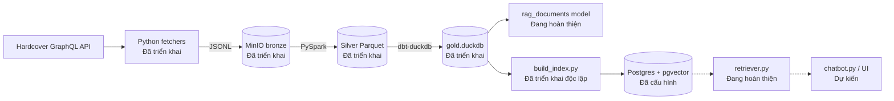
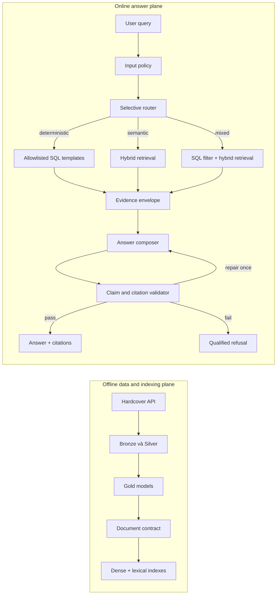
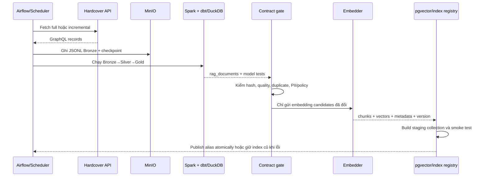
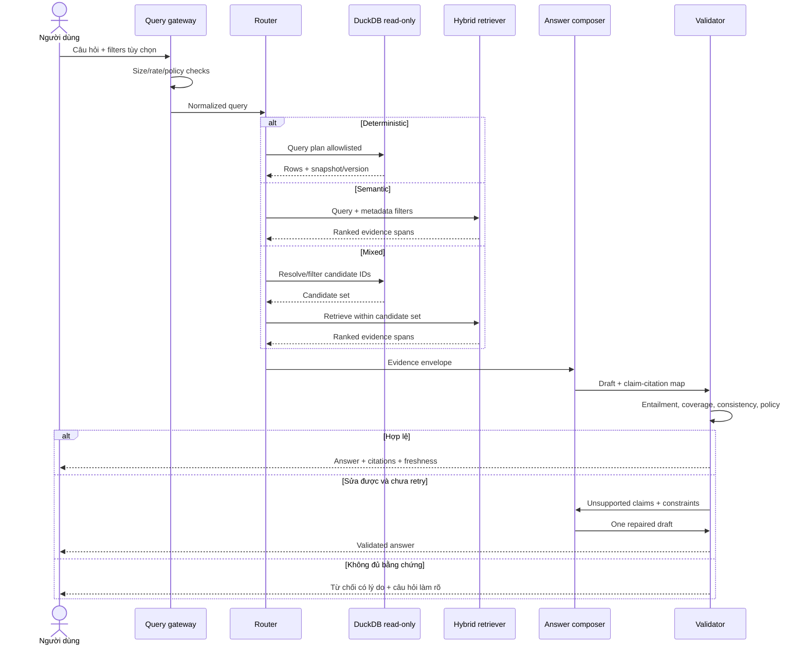
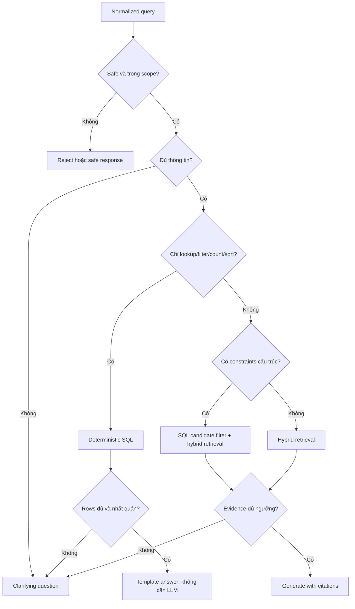
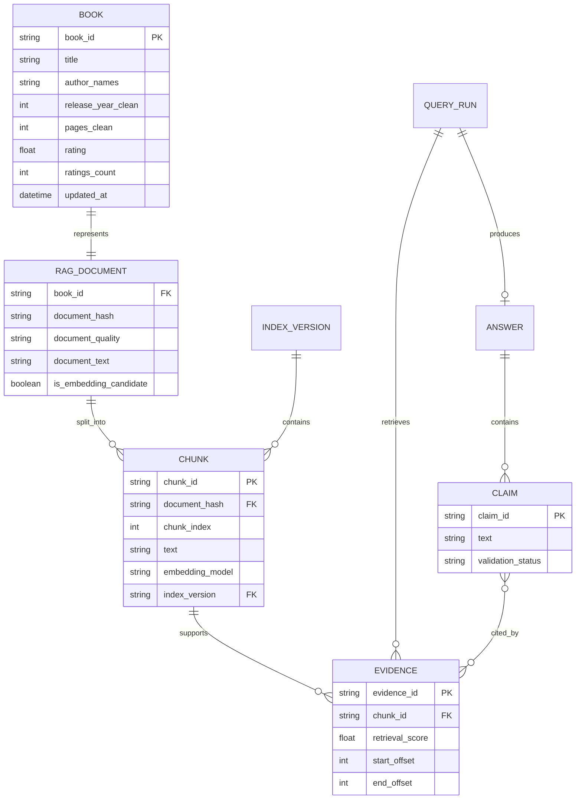

# Kiến trúc RAG tra cứu và gợi ý sách

> **Đối tượng đọc:** chủ sản phẩm, người vận hành dữ liệu, kỹ sư ứng dụng, người đánh giá chất lượng và bảo mật.  
> **Phạm vi:** mô tả đúng repository tại ngày 01/10/2026 và kiến trúc đích **Selective Deterministic-First Evidence-Grounded RAG**. Đây không phải tuyên bố rằng chatbot đã sẵn sàng production.

## 1. Tóm tắt điều hành

Ứng dụng biến dữ liệu danh mục sách Hardcover thành hai loại câu trả lời:

1. **Câu trả lời xác định** cho câu hỏi có thể tính chính xác bằng dữ liệu có cấu trúc, ví dụ “5 sách fantasy được đánh giá nhiều nhất sau năm 2020”. Hệ thống ưu tiên truy vấn DuckDB/SQL, không gọi mô hình ngôn ngữ nếu mẫu trả lời đủ rõ.
2. **Câu trả lời tổng hợp có bằng chứng** cho câu hỏi cần hiểu ngữ nghĩa, ví dụ “tìm tiểu thuyết u tối, nhịp nhanh, không có cảnh báo bạo lực”. Hệ thống truy hồi đoạn liên quan, sinh câu trả lời, gắn nguồn và kiểm tra từng nhận định trước khi trả về.

“Selective” nghĩa là chỉ dùng RAG khi cần. “Deterministic-First” nghĩa là ưu tiên phép lọc, sắp xếp và tính toán tái lập được. “Evidence-Grounded” nghĩa là nhận định về sách phải liên kết tới đoạn nguồn và không vượt quá bằng chứng.

**Hiện trạng:** ingestion, Bronze/Silver/Gold và mô hình tài liệu RAG đã có phần lớn mã nguồn; script dựng pgvector đã có. Lớp truy hồi chưa hoàn chỉnh và chatbot chỉ là placeholder. Router, hybrid retrieval, generation, citation validation và API/UI truy vấn mới là thiết kế đích.

### Ký hiệu trạng thái

| Nhãn | Nghĩa |
|---|---|
| **Đã triển khai** | Có mã nguồn thực thi hoặc cấu hình hiện hữu trong repository. Không đồng nghĩa đã chạy production. |
| **Đang hoàn thiện** | Có mã nhưng còn lỗi/chênh lệch contract hoặc chưa nối thành luồng chạy được. |
| **Dự kiến** | Thiết kế mục tiêu; chưa có implementation trong repository. |

## 2. Mục tiêu, ngoài phạm vi và bên liên quan

### Mục tiêu

- Tra cứu metadata, thống kê và xếp hạng sách chính xác, tái lập được.
- Gợi ý/khám phá sách bằng ngôn ngữ tự nhiên dựa trên dữ liệu Hardcover đã ingest.
- Cho người dùng thấy sách, trường dữ liệu hoặc đoạn văn nào hỗ trợ câu trả lời.
- Từ chối hoặc hạ mức khẳng định khi bằng chứng thiếu, mâu thuẫn hay quá cũ.
- Đo riêng chất lượng routing, retrieval, citation, answer và độ trễ.

### Ngoài phạm vi hiện tại

- Không suy luận rằng đánh giá cộng đồng là sự thật khách quan hoặc tư vấn chuyên môn.
- Không xử lý hồ sơ, hoạt động đọc, likes hay danh sách cá nhân; pipeline chủ động loại dữ liệu hành vi người dùng.
- Không bảo đảm tồn kho, giá bán hay trạng thái phát hành theo thời gian thực.
- Không có conversational memory/personalization trong giai đoạn đầu.

### Stakeholders và use cases

| Bên liên quan | Nhu cầu | Tuyến ưu tiên |
|---|---|---|
| Độc giả | Tìm sách theo tác giả, thể loại, mood, pace, series, năm, số trang, cảnh báo nội dung | SQL cho bộ lọc rõ; hybrid RAG cho mô tả mơ hồ |
| Người làm nội dung/thủ thư | Kiểm tra metadata và nguồn của đề xuất | SQL + evidence/citation |
| Nhà phân tích | Top-N, phân phối rating, xu hướng danh mục | Chỉ SQL; xuất kết quả có query ID |
| Chủ sản phẩm | Chất lượng, chi phí, latency, tỷ lệ từ chối | Dashboard đánh giá và trace |
| Data engineer | Freshness, completeness, duplicate, lỗi pipeline | Airflow/dbt/data-quality logs |
| Kỹ sư ML/RAG | Recall, reranking, groundedness, citation correctness | Evaluation set và replay |
| Security/privacy reviewer | Bí mật, dữ liệu nhạy cảm, prompt injection, audit | Policy, redaction, allowlist, audit log |

## 3. Kiến trúc hiện tại: những gì code thực sự có

### Sự thật và khoảng cách cần chú ý

- `src/ingestion/cli.py` hỗ trợ full/incremental, checkpoint và registry 10 entity; `config/entities.yaml` quy định lịch cho 9 entity. Airflow có DAG full/daily/weekly.
- `src/clients/minio.py` ghi JSONL vào `bronze/<entity>/`; transform Bronze→Silver và các dbt model Silver→Gold hiện diện.
- `dim_books.sql` xây `chunk_text` từ title, authors, series, tags, moods, pace, content warnings, headline và description; `rag_documents.sql` thêm hash, khử trùng lặp và cờ `is_embedding_candidate`.
- `build_index.py` hiện đọc trực tiếp `dim_books`, lọc cả `Rich` và `Metadata`, giới hạn 10.000 sách, chunk 500 ký tự/overlap 50 rồi **xóa và dựng lại** collection `books`. Nó chưa dùng `rag_documents.is_embedding_candidate`, `document_hash` hay incremental indexing.
- `retriever.py` mới khởi tạo vector store; import `lanchain_comunity` bị sai chính tả, tên `load_vetorstore` cũng sai, chưa có hàm search/router/generation.
- `rag_documents.sql` bắt đầu bằng `ith source_books as (` thay vì `with`; `dim_books.sql` định nghĩa trùng `is_release_year_suspicious`. Đây là lỗi chặn build cần sửa trước khi coi Gold contract ổn định.
- `src/serve/chatbot.py` chỉ có một dòng; `dashboard.py` rỗng. Dependency RAG dùng trong code chưa được khai báo đầy đủ ở nhóm `serve` của `pyproject.toml`.
- README cũ mô tả một số đường dẫn/tiến độ không còn khớp repository; tài liệu này lấy code và model hiện hữu làm nguồn sự thật.

## 4. Kiến trúc đích: Selective Deterministic-First Evidence-Grounded RAG

Nguyên tắc:

1. **Không gọi LLM khi không cần:** lookup, count, aggregate, filter và top-N dùng query template/type-safe query builder trên read-only Gold.
2. **Không để LLM tự viết SQL tùy ý:** router tạo intent có schema; executor ánh xạ sang cột/toán tử allowlist và áp giới hạn dòng/thời gian.
3. **Hybrid khi ngữ nghĩa cần thiết:** lexical BM25 bắt tên riêng/từ khóa; dense search bắt diễn đạt tương đương; Reciprocal Rank Fusion (RRF) hợp nhất; reranker chỉ chạy trên top-N để giữ latency. Thiết kế này cần thắng baseline trong evaluation trước khi bật.[^lit3r] [^shopease]
4. **Metadata trước, nội dung sau:** filter năm, pages, content warnings và entity ID trước hoặc trong retrieval; xác minh candidate bằng metadata thay vì tin hoàn toàn vào embedding.[^tatk]
5. **Mỗi claim phải có evidence span:** nén context không được làm mất liên kết claim–citation–source.[^attribution]
6. **Fail closed:** không đủ evidence thì nêu thiếu dữ liệu, không bịa đề xuất.

## 5. Luồng offline: ingestion đến chỉ mục

**Failure handling đích:** retry API có backoff; checkpoint không tiến khi upload thất bại; dbt test thất bại chặn indexing; embedding theo `document_hash` để resume/idempotent; staging collection chỉ thay alias sau count/checksum/search smoke test; index cũ tiếp tục phục vụ nếu publish lỗi. Rebuild phá hủy bằng `pre_delete_collection=True` hiện tại phải được thay trước production.

## 6. Luồng online: câu hỏi đến câu trả lời

## 7. Router: quyết định có tính chọn lọc

Router xuất object có version: `intent`, `route`, `entities`, `filters`, `sort`, `limit`, `semantic_query`, `confidence`, `reason_codes`. Rule-based parser xử lý mẫu rõ trước; classifier chỉ xử lý phần còn lại. Confidence thấp không tự chọn RAG mà hỏi lại. Mọi route ghi log để xây confusion matrix.

## 8. Contract dữ liệu và bằng chứng

### Document contract tối thiểu

| Field | Nguồn hiện tại | Quy tắc đích |
|---|---|---|
| `book_id`, `title` | `dim_books` | Bắt buộc; ID ổn định; title không dùng placeholder cho embedding candidate |
| `document_text` | `rag_documents` từ `chunk_text` | Bắt buộc, normalized; không diễn giải là review nguyên bản |
| `document_hash` | MD5 text normalized | Dùng phát hiện thay đổi/dedupe, không dùng làm cơ chế bảo mật |
| `document_quality` | `Rich/Metadata/Poor` | Chỉ candidate theo policy đã version hóa |
| `is_embedding_candidate` | Rich, title hợp lệ, ≥200 ký tự, duplicate rank 1 | Nguồn quyết định duy nhất cho indexing sau khi contract ổn định |
| Metadata filters | authors, genres, moods, series, rating, counts, pages, year, flags | Kiểu dữ liệu rõ; giá trị đáng ngờ dùng trường `*_clean` hoặc bị loại |
| Provenance đích | Chưa có đầy đủ | `source=Hardcover`, `source_updated_at`, `warehouse_snapshot`, `model_version`, `index_version` |
| Chunk identity đích | Hiện chỉ `chunk_idx` trong metadata | `chunk_id = hash(document_hash, chunk_policy_version, chunk_index)` |

## 9. Trạng thái kiểm chứng câu trả lời

```mermaid
stateDiagram-v2
    accTitle: Máy trạng thái kiểm chứng câu trả lời
    accDescr: Draft được tách claim, ánh xạ bằng chứng và kiểm tra; claim không hỗ trợ kích hoạt một lần sửa, sau đó chỉ trả khi đạt chuẩn, nếu không hệ thống từ chối có kiểm soát.
    [*] --> Drafted
    Drafted --> ClaimsExtracted
    ClaimsExtracted --> EvidenceMapped
    EvidenceMapped --> Validating
    Validating --> Validated: coverage, entailment, consistency pass
    Validating --> Repairable: thiếu citation hoặc claim có thể bỏ
    Repairable --> Drafted: sửa tối đa một lần
    Repairable --> Refused: đã hết retry
    Validating --> Refused: evidence thiếu hoặc mâu thuẫn
    Validated --> Delivered
    Refused --> Delivered
    Delivered --> [*]
```

Validator kiểm ít nhất: citation tồn tại; span thuộc đúng sách/chunk/version; claim số học khớp row SQL; claim mô tả được evidence hỗ trợ; mọi sách được đề xuất có ít nhất một bằng chứng; không có citation trang trí; answer nêu snapshot/freshness khi dữ liệu có thể thay đổi. CiteGuard-RAG là tham khảo cho validation ở mức câu và vòng regenerate/refuse, không phải bằng chứng rằng implementation hiện tại đã có tính năng này.[^citeguard]

## 10. Component, trách nhiệm, I/O và lỗi

| Component/file | Trạng thái | Trách nhiệm | Input → Output | Failure handling hiện tại / đích |
|---|---|---|---|---|
| `src/clients/hardcover.py` | Đã triển khai | GraphQL client | query/variables → records | Retry HTTP; lỗi nổi lên caller |
| `src/ingestion/fetchers/*`, `cli.py` | Đã triển khai | Pagination, full/incremental, checkpoint | API records → JSONL batches | Resume/checkpoint; fail sớm khi thiếu secret/MinIO |
| `src/clients/minio.py` | Đã triển khai | Object storage Bronze | bytes/files → `bronze/...` | Log `S3Error`; upload batch trực tiếp |
| `src/transform/bronze_to_silver/*` | Đã triển khai | Flatten/type/clean cấu trúc | Bronze JSONL → Silver Parquet | Spark job failure; cần quarantine + row metrics |
| `src/transform/silver_to_gold/models/*` | Đang hoàn thiện | Business models, dimensions, facts, RAG document | Silver → DuckDB Gold | dbt tests có; lỗi SQL nêu ở §3 phải sửa; test fail phải chặn publish |
| `rag_documents.sql` | Đang hoàn thiện | Contract trước chunking | `dim_books` → one document/book | Dedupe/hash/candidate có; cú pháp hiện lỗi |
| `src/serve/rag/build_index.py` | Đã triển khai độc lập | Chunk, embed, ghi PGVector | `dim_books` rows → collection `books` | Hiện rebuild phá hủy; đích staging + atomic alias + resume |
| `src/serve/rag/retriever.py` | Đang hoàn thiện | Load vector store | env config → PGVector handle | Hiện import lỗi, thiếu search và guard cấu hình |
| Router/query planner | Dự kiến | Chọn deterministic/semantic/mixed | normalized query → typed plan | Confidence thấp hỏi lại; plan invalid bị từ chối |
| SQL executor | Dự kiến | Chạy template trên Gold read-only | typed plan → rows/evidence | Allowlist, timeout, row cap, circuit breaker |
| Hybrid retriever/reranker | Dự kiến | BM25+dense+RRF, optional rerank | query/filter → evidence spans | Minimum score/diversity; fallback từng retriever |
| Answer composer | Dự kiến | Template hoặc LLM grounded generation | evidence envelope → draft/claims | Context budget; không evidence không generate |
| Validator | Dự kiến | Claim/citation/number/policy checks | draft + evidence → pass/repair/refuse | Một retry, sau đó fail closed |
| `src/serve/chatbot.py` | Dự kiến | Giao diện/API người dùng | request → answer contract | Placeholder hiện tại; đích request ID và safe errors |

## 11. Bảo mật và riêng tư

- Secrets chỉ qua environment/secret store; không log `HARDCOVER_API_KEY`, MinIO key hay DB password. Giá trị mặc định `rag/rag`, `minioadmin` và Airflow `admin/admin` trong Compose chỉ phù hợp local; production phải đổi, tắt expose config và không public port quản trị.
- Tài khoản online chỉ có quyền `SELECT` trên view allowlist; vector DB tách quyền writer của indexer và reader của retriever. TLS cho API, MinIO và Postgres ngoài localhost.
- Query SQL được compile từ schema allowlist, parameterized, có timeout/row limit; không thực thi SQL do người dùng hoặc LLM tạo tự do.
- Nội dung truy hồi là **dữ liệu**, không phải instruction. Prompt cô lập evidence, escape delimiter và bỏ qua chỉ thị nằm trong description để chống indirect prompt injection.
- Giới hạn độ dài, rate, concurrency; lọc log để không lưu secrets hay toàn bộ câu hỏi nếu chưa có consent/retention policy.
- Pipeline hiện chủ động không ingest entity hành vi cá nhân. Nếu thêm personalization, cần consent, purpose limitation, TTL, export/delete và đánh giá privacy riêng.
- Citation không biến dữ liệu bên thứ ba thành dữ liệu sở hữu; UI cần attribution, liên kết nguồn và tuân thủ điều khoản Hardcover.
- Backup mã hóa; kiểm thử restore; audit log bất biến cho index publish, policy version và route/answer decision.

## 12. Observability và vận hành

Mỗi request có `request_id`; mỗi artifact có `pipeline_run_id`, `warehouse_snapshot`, `document_hash`, `index_version`, `embedding_model`, `router_version`, `prompt_version` và `validator_version`.

- **Data:** records/entity, API lag, checkpoint age, Bronze→Silver rejects, dbt test pass, null/duplicate rate, `% Rich/Metadata/Poor`, embedding candidate count.
- **Index:** documents/chunks added/changed/deleted, embed failures, index age, vector dimension, publish duration, active version, lexical/vector parity.
- **Online:** route distribution, clarification/refusal/repair rate, retrieval score, zero-result rate, citations/claim, unsupported-claim rate, p50/p95/p99 latency và error rate theo component.
- **Cost/capacity:** tokens, LLM calls avoided bởi deterministic route, embedding throughput, DB CPU/memory/connections.
- **Tracing:** span cho gateway, router, SQL, lexical, dense, rerank, generation, validation; không ghi raw secrets/evidence nhạy cảm.
- **Alert:** stale index, data contract fail, sudden zero-result spike, citation validation drop, latency/error budget breach. Rollback bằng active index/prompt/router version trước đó.

## 13. Đánh giá và tiêu chí phát hành

Tạo bộ câu hỏi tiếng Việt có nhãn, phân tầng theo lookup, aggregate, filter, semantic, mixed, ambiguous, unanswerable và adversarial. Chia theo book/entity để tránh rò rỉ giữa tuning và test.

| Lớp | Metrics |
|---|---|
| Data/contract | freshness, completeness, uniqueness, candidate precision, duplicate rate |
| Router | route accuracy, macro-F1, unsafe-route rate, clarification precision, LLM-call avoidance |
| Retrieval | Recall@k, Precision@k, MRR, nDCG@k, evidence span recall, book diversity |
| Answer | exact match/F1 cho lookup, numeric accuracy, recommendation relevance, completeness |
| Grounding | claim support rate, citation correctness, citation coverage, contradiction rate, refusal precision/recall |
| Hệ thống | p50/p95 latency, availability, error rate, cost/request, tokens/request |

Phải chạy ablation: SQL-only; dense-only hiện tại; lexical-only; BM25+dense+RRF; thêm reranker; thêm validator. Không đưa thành phần phức tạp vào production nếu không tăng chất lượng đủ bù latency/cost.[^shopease] Chunk nhỏ và parent context lớn chỉ thử sau baseline, vì lợi ích phụ thuộc corpus.[^ear]

**Quality gates đề xuất trước public beta:** 100% numeric claims khớp result set; ≥95% citation correctness trên test set; không unsupported claim nghiêm trọng trong adversarial set; router macro-F1 ≥0,90; p95 không-LLM ≤1 giây và RAG ≤8 giây trên hạ tầng mục tiêu. Các ngưỡng này là mục tiêu sản phẩm ban đầu, cần hiệu chỉnh bằng dữ liệu đo.

## 14. Roadmap theo pha

### Pha 0 — Làm baseline chạy đúng

- Sửa SQL contract và import retriever; khai báo dependencies thật; thêm test build dbt và smoke test vector search.
- Đồng nhất indexer với `rag_documents.is_embedding_candidate`; bỏ giới hạn 10.000 hoặc biến thành tham số rõ.
- Hoàn thành deterministic SQL lookup/filter/top-N và response contract; chưa cần LLM.

**Exit:** clean checkout dựng Gold và index thành công; câu hỏi deterministic trả kết quả có snapshot.

### Pha 1 — Dense RAG có bằng chứng

- Incremental indexing theo hash, staging collection, atomic publish.
- Dense top-k, metadata filter, evidence span/ID ổn định; answer chỉ dùng evidence và citation bắt buộc.
- Evaluation set, tracing và dashboard metrics cơ bản.

**Exit:** đạt baseline Recall@k, citation correctness và latency đã chốt.

### Pha 2 — Selective hybrid và validation

- Router rule-first với ba tuyến SQL/semantic/mixed.
- BM25+dense+RRF; reranker chỉ bật nếu ablation thắng.
- Claim-level validator, numeric checker, repair một lần và qualified refusal.[^citeguard] [^lit3r]

**Exit:** đạt quality gates §13 và red-team prompt injection.

### Pha 3 — Hardening production

- AuthN/AuthZ, TLS, secret rotation, backups/restore, retention/audit, rate limiting, SLO và runbook rollback.
- Canary index/prompt/router version; human review cho sample lỗi; feedback không tự động trở thành ground truth.

**Exit:** security review, load test, disaster-recovery drill và owner trực vận hành.

### Pha 4 — Tùy chọn, chỉ khi có nhu cầu đo được

- Conversation memory và preference update với replay evaluation; xử lý preference mới thay thế preference cũ.[^lsrep] [^immutable]
- Parent-child retrieval/chunk policy mới; personalization có consent.

**Exit:** cải thiện offline + online experiment, không làm giảm privacy/grounding.

## 15. Rủi ro và quyết định mở

- Metadata/tag do cộng đồng tạo có thể thiếu, thiên lệch hoặc mâu thuẫn; phải hiển thị đây là dữ liệu danh mục, không phải phán quyết khách quan.
- Rating là current-state; `fact_book_metrics` chưa lưu lịch sử, nên không trả lời xu hướng theo thời gian nếu thiếu snapshot.
- Dense model `all-MiniLM-L6-v2` cần benchmark riêng cho truy vấn tiếng Việt và title/tên riêng; không mặc định đa ngôn ngữ đủ tốt.
- Character chunking 500/50 hiện tại đơn giản nhưng có thể cắt field/span; giữ làm baseline rồi đo trước khi đổi.
- Các paper tham khảo là preprint mới, trên domain khác; kỹ thuật chỉ được nhận sau evaluation trên corpus sách của dự án.

## Tài liệu tham khảo

[^citeguard]: *CiteGuard-RAG*, arXiv: https://arxiv.org/abs/2609.15830v1
[^tatk]: *TATK*, arXiv: https://arxiv.org/abs/2609.14565v1
[^lit3r]: *Lit3R*, arXiv: https://arxiv.org/abs/2609.16912v1
[^attribution]: *Attribution-Compression Frontier*, arXiv: https://arxiv.org/abs/2609.14245v1
[^shopease]: *ShopEase*, arXiv: https://arxiv.org/abs/2609.13856v1
[^lsrep]: *LSREP*, arXiv: https://arxiv.org/abs/2609.16730v1
[^immutable]: *The Immutable Past*, arXiv: https://arxiv.org/abs/2609.16073v1
[^ear]: *EAR*, arXiv: https://arxiv.org/abs/2609.12268v1
