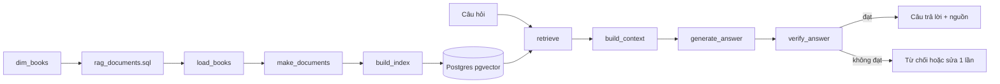
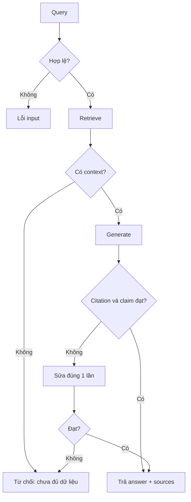

# Hướng dẫn tự triển khai RAG cho book-pipeline

> Mục tiêu: tự viết từng phần, hiểu dữ liệu đi đâu và kiểm tra được từng bước. Tài liệu chỉ đưa khung, hợp đồng hàm và giả mã; không thay người học viết toàn bộ mã production.

## 1. Trạng thái source đã đọc

| File | Trạng thái thật | Vấn đề hiện tại |
|---|---|---|
| `src/transform/silver_to_gold/models/rag_documents.sql` | Có 3 CTE và chọn ứng viên embedding | Ký tự đầu bị mất: `ith source_books as (` phải là `with source_books as (`; dbt compile sẽ lỗi cú pháp. |
| `src/serve/rag/build_index.py` | Có `load_books`, `make_documents`, `build_index`, `main` | Đọc trực tiếp `dim_books`, chưa dùng model `rag_documents`; lọc `Rich` **hoặc** `Metadata`, trái với `is_embedding_candidate` chỉ nhận `Rich`, không thiếu title, dài ≥ 200, bản không trùng. Dùng `pages`/`release_year` thô thay vì trường clean. `pre_delete_collection=True` xóa collection trước rebuild nên lỗi giữa chừng có thể làm index khả dụng biến mất. |
| `src/serve/rag/retriever.py` | Chỉ có `load_vetorstore` | Import sai chính tả: `lanchain_comunity` phải là `langchain_community`; tên hàm `load_vetorstore` thiếu `c`; `re` và `duckdb` chưa dùng; biến môi trường không có default nên chuỗi kết nối dễ chứa `None`; chưa có hàm retrieve. |
| `src/serve/chatbot.py` | Chỉ có một dòng trắng | Chưa triển khai. |
| `context_builder.py`, `generator.py`, `verifier.py` | Không tồn tại trong source | Mới planned; không được giả định API đã có. |
| `pyproject.toml` | Extra `serve` chỉ có Streamlit | Thiếu các dependency đang được import: DuckDB, dotenv, LangChain Postgres/community/text splitters, psycopg, sentence-transformers. `requirements.txt` có một số gói nhưng chưa phải hợp đồng cài đặt đồng nhất. |
| `docker-compose.yml` | Có `postgres-vector`, cổng host `5433` | Chạy local Python dùng `localhost:5433`; code chạy trong container phải dùng `postgres-vector:5432`. |

Ngoài ra, `rag_documents.sql` hiện coi `chunk_text` là toàn document rồi `build_index.py` lại chia chunk. Đây là hợp lý nếu đặt tên rõ: dbt tạo **document**, Python tạo **retrieval chunk**.

## 2. Call chain đích



Hai luồng độc lập:

1. **Offline:** `dbt run --select rag_documents` → `build_index.main()`.
2. **Online:** `chatbot` → `retriever.retrieve()` → `context_builder.build_context()` → `generator.generate_answer()` → `verifier.verify_answer()`.

Không cho generator gọi thẳng vector store. Tách vậy để đo recall truy hồi và faithfulness sinh đáp án riêng.

## 3. `rag_documents.sql`: tạo đơn vị tài liệu sạch

### Cú pháp cần hiểu

- `{{ config(materialized='table') }}`: Jinja của dbt; kết quả được materialize thành bảng.
- `{{ ref('dim_books') }}`: dbt tạo dependency và resolve schema.
- `nullif(trim(x), '')`: chuỗi rỗng thành `NULL`.
- `try_cast`: cast lỗi trả `NULL`, không làm hỏng cả query.
- `regexp_replace(..., '[[:space:]]+', ' ', 'g')`: gom mọi khoảng trắng trước khi hash.
- `md5(...)`: khóa phát hiện document trùng sau chuẩn hóa.
- `row_number() over (partition by ... order by ...)`: giữ bản đại diện tốt nhất cho mỗi hash.

### Input / output

**Input:** mỗi row `dim_books`, gồm metadata, cờ chất lượng và `chunk_text`.

**Output:** một row/document với toàn bộ metadata nguồn cộng:

| Cột | Kiểu/ý nghĩa |
|---|---|
| `document_text` | text không rỗng dùng để chunk |
| `document_quality` | chất lượng từ `dim_books`, không tính lại |
| `document_length` | số ký tự, không phải token |
| `document_hash` | hash text đã lower/trim/gom whitespace |
| `document_duplicate_rank` | 1 là bản đại diện |
| `is_embedding_candidate` | boolean quyết định được index hay không |

### Bài tập triển khai

```sql
{{ config(materialized='table') }}

with source_books as (
    -- TODO 1: chọn trường cần cho retrieval và provenance từ {{ ref('dim_books') }}
    -- TODO 2: tạo release_year_clean, document_text, document_quality
),
hashed_documents as (
    -- TODO 3: loại document_text NULL
    -- TODO 4: tính document_length và document_hash ổn định
),
ranked_documents as (
    -- TODO 5: row_number theo document_hash; ưu tiên ratings_count rồi book_id
)
select
    *,
    -- TODO 6: biểu thức boolean is_embedding_candidate
from ranked_documents
```

Tự kiểm tra:

```sql
select count(*) from rag_documents;
select count(*) from rag_documents where is_embedding_candidate;
select document_hash, count(*)
from rag_documents
where document_duplicate_rank = 1
group by 1 having count(*) > 1;
```

Query cuối phải trả 0 row. Đừng hash metadata: hai sách có mô tả giống nhau cần được nhận diện trùng nội dung.

## 4. `build_index.py`: ETL từ DuckDB sang pgvector

### Hợp đồng hàm

#### `load_books(limit: int) -> list[dict]`

- **Input:** số nguyên dương `limit`.
- **Output:** danh sách dict; mỗi dict là một candidate từ `rag_documents`.
- **Lỗi phải xử lý:** `limit <= 0`, DB không tồn tại, model chưa build.
- Dùng context manager hoặc `try/finally` để luôn đóng DuckDB.

```python
def load_books(limit: int) -> list[dict]:
    """Đọc tối đa limit ứng viên embedding, thứ tự xác định."""
    assert limit > 0
    # TODO: connect read_only
    # TODO: SELECT ... FROM rag_documents WHERE is_embedding_candidate
    # TODO: ORDER BY ratings_count DESC NULLS LAST, book_id
    # TODO: zip tên cột với row
```

#### `make_documents(books: list[dict]) -> list[Document]`

- **Input:** book dict có `document_text`, `book_id`, title và metadata.
- **Output:** các `Document(page_content=..., metadata=...)`.
- Mỗi chunk cần ID ổn định, ví dụ `book_id:chunk_idx`; metadata phải đủ để trích nguồn.
- `chunk_size=500` của source hiện tại là **ký tự** theo splitter, không phải token.

```python
def make_documents(books: list[dict]) -> list[Document]:
    splitter = RecursiveCharacterTextSplitter(
        chunk_size=500,
        chunk_overlap=50,
        separators=["\n\n", "\n", ". ", " "],
    )
    # TODO: bỏ text trắng
    # TODO: chuẩn hóa metadata thành kiểu JSON/Postgres hỗ trợ
    # TODO: split_text; tạo Document với chunk_idx và source_id
```

Cú pháp `{**metadata, "chunk_idx": i}` tạo dict mới; không sửa dict gốc. Tránh `if b["rating"]` khi `0` là dữ liệu hợp lệ; dùng `is not None`.

#### `build_index(docs: list[Document]) -> PGVector`

- **Input:** danh sách chunk không rỗng.
- **Output:** vector store đã ghi.
- Embedding query và document phải dùng cùng `EMBED_MODEL` và cùng normalize setting.

```python
def build_index(docs: list[Document]) -> PGVector:
    if not docs:
        raise ValueError("Không có document để index")
    # TODO: tạo HuggingFaceEmbeddings
    # TODO: ghi sang collection staging
    # TODO: chỉ chuyển sang collection live sau khi ghi thành công
    # ponytail: nếu bài học chỉ chạy local, có thể rebuild live collection;
    # nâng cấp staging/swap khi index phục vụ người dùng liên tục.
```

`pre_delete_collection=True` tiện cho bài học nhưng không atomic. Giữ chỉ khi chấp nhận downtime và đã ghi rõ rủi ro.

#### `main() -> None`

Điều phối, không chứa logic nghiệp vụ:

```text
đọc config → validate config → load_books → make_documents
→ fail nếu 0 chunks → build_index → in số liệu
```

Nên log: số book, số chunk, số book bị bỏ, model, collection. Không log password/connection string đầy đủ.

## 5. `retriever.py`: truy hồi có điểm và nguồn

Sửa lỗi import trước. Chuẩn hóa tên thành `load_vectorstore`; nếu code khác đã dùng tên cũ thì giữ alias tạm, nhưng project hiện chưa có caller nên đổi thẳng là đủ.

### `load_vectorstore() -> PGVector`

- **Input ngầm:** biến môi trường.
- **Output:** handle tới collection `books`; không rebuild.
- Validate từng biến trước khi tạo URL. Dùng default giống `build_index.py` để hai file không trỏ hai DB khác nhau.

```python
def load_vectorstore() -> PGVector:
    # TODO: validate host/port/db/user/password
    # TODO: cùng embedding model + normalize_embeddings=True
    # TODO: return PGVector(...)
```

### `retrieve(query: str, k: int = 6) -> list[RetrievedChunk]`

Dùng một `TypedDict` hoặc dict nhỏ, chưa cần class hierarchy:

```python
class RetrievedChunk(TypedDict):
    text: str
    metadata: dict
    score: float


def retrieve(query: str, k: int = 6) -> list[RetrievedChunk]:
    # TODO: strip và reject query rỗng; kiểm tra 1 <= k <= 20
    # TODO: similarity_search_with_score(query, k=k)
    # TODO: map Document + score thành contract trên
    # TODO: dedupe source_id nếu overlap tạo đoạn gần như lặp
```

**Chú ý score:** xác nhận API đang trả distance hay relevance trước khi đặt ngưỡng; không mặc định “cao hơn tốt hơn”. Viết một test tay với câu hỏi chứa đúng title để quan sát.

## 6. Các module planned

Đề xuất đặt cùng `src/serve/rag/`; chỉ tạo khi bắt đầu milestone tương ứng.

### `context_builder.py`

```python
def build_context(chunks: list[RetrievedChunk], max_chars: int = 6_000) -> str:
    """Ghép context có nhãn nguồn, không cắt vượt budget."""
    # TODO: validate max_chars
    # TODO: format [S1] title, author, book_id, chunk_idx + text
    # TODO: bỏ duplicate, thêm theo rank tới budget
```

**Input:** chunk đã xếp hạng. **Output:** chuỗi có marker `[S1]`, `[S2]`; không gọi LLM. Giữ tài liệu tốt nhất ở đầu và cuối để giảm “lost in the middle”.

### `generator.py`

```python
def generate_answer(question: str, context: str) -> dict:
    # TODO: prompt yêu cầu chỉ dùng context
    # TODO: output JSON {"answer": str, "citations": list[str]}
    # TODO: timeout, lỗi parse, một lần repair JSON tối đa
```

**Input:** câu hỏi + context đã đánh số. **Output:** answer có citation. Nếu context rỗng, từ chối trước khi gọi model.

### `verifier.py`

```python
def verify_answer(answer: dict, context: str) -> dict:
    # TODO: citations đều tồn tại trong context
    # TODO: tách claim/câu; kiểm tra mỗi claim có citation
    # TODO: kiểm tra overlap tối thiểu; chưa đủ thì fail-closed
    # output: {"passed": bool, "unsupported": [...], "reason": str}
```

Bản đầu nên deterministic. NLI/LLM verifier để sau local evaluation; verifier cùng model với generator dễ tự xác nhận lỗi của chính nó.

### `chatbot.py`

```python
def answer(question: str) -> dict:
    chunks = retrieve(question)
    context = build_context(chunks)
    draft = generate_answer(question, context)
    verdict = verify_answer(draft, context)
    # TODO: đạt thì trả answer + nguồn
    # TODO: không đạt thì từ chối; tùy chọn regenerate đúng 1 lần
```

UI Streamlit chỉ thu input và render output. Không nhét retrieval/generation logic vào callback UI.

## 7. Luồng lỗi



## 8. Lệnh Windows CMD chạy được

Chạy từ root `D:\lap_trinh\my_project\book-pipeline`:

```bat
cd /d D:\lap_trinh\my_project\book-pipeline
.venv\Scripts\activate.bat
```

Cài dependency hiện được source dùng. Vì `pyproject.toml` chưa khai báo đủ, lệnh tạm cho môi trường học:

```bat
python -m pip install duckdb python-dotenv langchain-postgres langchain-community langchain-text-splitters sentence-transformers "psycopg[binary]"
```

Khởi động pgvector và kiểm tra health:

```bat
docker compose up -d postgres-vector
docker compose ps postgres-vector
```

Đặt biến cho phiên CMD hiện tại:

```bat
set DUCKDB_PATH=data\warehouse\gold.duckdb
set VECTOR_DB_HOST=localhost
set VECTOR_DB_PORT=5433
set VECTOR_DB_NAME=books_rag
set VECTOR_DB_USER=rag
set VECTOR_DB_PASSWORD=rag
```

Build dbt model sau khi sửa lỗi `with`:

```bat
cd src\transform\silver_to_gold
dbt run --select rag_documents --profiles-dir .
dbt test --select rag_documents --profiles-dir .
cd /d D:\lap_trinh\my_project\book-pipeline
```

Smoke-check model:

```bat
.venv\Scripts\python -c "import duckdb; c=duckdb.connect(r'data/warehouse/gold.duckdb',read_only=True); print(c.execute('select count(*), count(*) filter (where is_embedding_candidate) from rag_documents').fetchone())"
```

Build index:

```bat
.venv\Scripts\python src\serve\rag\build_index.py
```

Sau khi viết `retrieve`, smoke-check:

```bat
.venv\Scripts\python -c "from serve.rag.retriever import retrieve; r=retrieve('sách fantasy có không khí u tối', 3); assert len(r)<=3; print([(x['metadata'].get('title'), x['score']) for x in r])"
```

Sau khi viết `chatbot.answer`:

```bat
.venv\Scripts\python -c "from serve.chatbot import answer; print(answer('Gợi ý sách fantasy được đánh giá cao và giải thích bằng nguồn.'))"
```

## 9. Checklist học xong

- [ ] `dbt run --select rag_documents` hết syntax error.
- [ ] Index chỉ lấy `is_embedding_candidate = true`.
- [ ] Chunk có `book_id`, `chunk_idx`, `source_id` ổn định.
- [ ] Query và document dùng cùng embedding config.
- [ ] Retrieval trả score và provenance, không chỉ text.
- [ ] Context có budget và marker nguồn.
- [ ] Generator từ chối khi thiếu context, trả JSON có citations.
- [ ] Verifier chặn citation giả và claim không nguồn.
- [ ] Có bộ câu hỏi local đo retrieval Recall@k, grounded answer, refusal và latency trước mọi tối ưu phức tạp.
