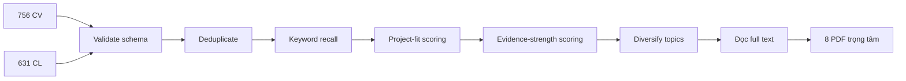
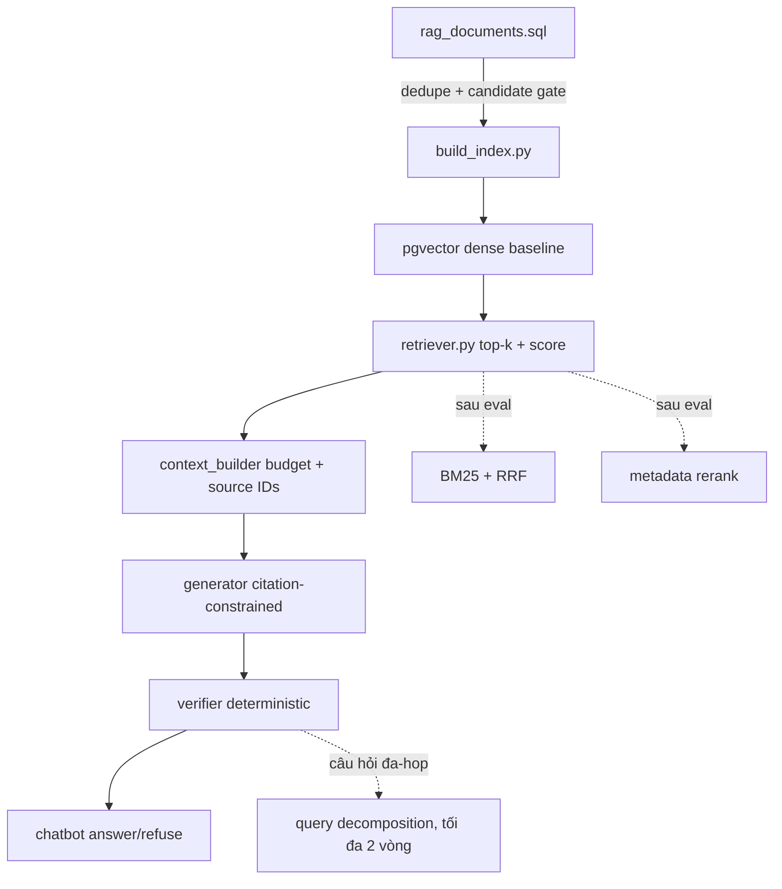

# Báo cáo nghiên cứu cho RAG book-pipeline

## 1. Phạm vi và cách sàng lọc

Hai nguồn JSON nằm ngoài repository tại `D:\lap_trinh\my_project\ViRISK\tools\cs_CV_recent.json` và `D:\lap_trinh\my_project\ViRISK\tools\cs_CL_recent.json`. Kiểm tra trực tiếp cho thấy chúng lần lượt chứa **756 paper CV** và **631 paper CL** (tổng 1.387 record). Tám PDF trọng tâm đã được tải vào `docs/papers/` để lưu bằng chứng nghiên cứu cùng dự án.

Quy trình sàng lọc có thể tái lập khi lấy lại JSON:

1. **Validate:** record có `id`, `title`, `abstract`, URL; loại trùng theo arXiv ID, rồi normalized title.
2. **Keyword recall cao:** tìm trong title + abstract các nhóm `retrieval/RAG`, `embedding`, `rerank/rank fusion`, `ground/citation/attribution`, `verify/faithful`, `recommend`, `memory/update`, `evaluation`.
3. **Project fit:** ưu tiên paper áp dụng được vào corpus sách, pgvector, chatbot có nguồn; hạ điểm paper chỉ về vision thuần hoặc training model lớn.
4. **Evidence strength:** ưu tiên có benchmark, baseline đơn giản, ablation, paired test, latency/cost và limitations rõ.
5. **Diversity:** giữ paper phủ retrieval, partition/chunk, recommendation, verification, mutable memory, longitudinal evaluation; tránh 8 paper cùng một kỹ thuật.
6. **Full-text check:** đọc PDF, ghi chính xác claim, setting và giới hạn; không suy rộng từ abstract.

Giả mã bộ lọc:

```python
records = load("cv.json") + load("cl.json")
records = dedupe(records, keys=["arxiv_id", "normalized_title"])
for paper in records:
    paper.score = keyword_score(paper) + project_fit(paper)
    paper.score += evidence_bonus(paper) - scope_mismatch_penalty(paper)
shortlist = diversify(sorted(records, key=lambda p: p.score, reverse=True))
manual_read(shortlist)
```



## 2. Paper trọng tâm và kỹ thuật rút ra

> Các paper mang ID `2609.*` là preprint rất mới so với ngày báo cáo 2026-10-01. Kết quả chưa phải bằng chứng production cho project này.

| Paper | Kết quả đáng chú ý | Bài học dùng được |
|---|---|---|
| **EAR** — Entity-Aware Partitioning (`2609.12268`) | Entity-window giảm khoảng 37,5–40,2% số từ so với chunk; chênh accuracy không có ý nghĩa sau correction. Parent expansion không ổn định. | Chunk nhỏ quanh anchor có thể giảm context; phải A/B test, không mặc định tăng accuracy. |
| **ShopEase** (`2609.13856`) | FAISS-only 85,37%, weighted RRF 85,07% không khác có ý nghĩa; cross-encoder chậm hơn và kém hơn trong setting đó; Unknown recall 0%. | Dense baseline trước; đo rejection/out-of-scope; reranker chỉ thêm sau khi chứng minh lợi ích local. |
| **Attribution Compression** (`2609.14245`) | PDF local là image/không extract được text bằng công cụ hiện có. | Không trích claim định lượng khi chưa OCR/xác minh; chỉ giữ làm nguồn cần đọc lại. |
| **TATK** (`2609.14565`) | Metadata-derived graph và top-M verification cải thiện ranking trên benchmark paper; noisy relations làm giảm chất lượng. | Metadata sách có thể làm tín hiệu rerank nhẹ, nhưng chỉ sau dense baseline và phải gate theo độ tin cậy. |
| **CiteGuard-RAG** (`2609.15830`) | Citation-constrained generation + sentence validation + một lần regenerate. External shift làm accuracy/refusal xấu rõ dù citation validity cao. | Tách retrieval/generation/verification; citation hợp lệ chưa đồng nghĩa answer đúng; fail-closed và đo false refusal. |
| **Immutable Past / GC-Mem** (`2609.16073`) | Prune mâu thuẫn theo thời gian hữu ích khi detector recall đủ; synthetic, single-attribute, chi phí pairwise. | Chưa cần cho corpus sách tương đối tĩnh; nếu thêm hội thoại/mutable facts, version timestamp và kiểm tra contradiction. |
| **LSREP** (`2609.16730`) | Hệ phức tạp hòa baseline trong replay thường, thắng stress mật độ nhưng thua vector baseline mạnh trên LongMemEval; audit phát hiện component lỗi/không chạy. | Audit “component có thật sự chạy” và benchmark baseline đơn giản; báo riêng failure, token, latency. |
| **Lit3R** (`2609.16912`) | Hybrid + iterative verification + paper expansion đạt recall@50 cao; multi-paper gain từ expansion, nhưng chỉ 55 validation questions và một benchmark. | Query decomposition và iterative retrieve hữu ích cho câu hỏi đa bằng chứng; quá nặng cho MVP book QA. |

## 3. Mapping vào source hiện tại



| Nhu cầu project | Source đích | Kỹ thuật | Metric quyết định |
|---|---|---|---|
| Không index sách lỗi/trùng | `rag_documents.sql`, `build_index.py` | quality gate + normalized hash | số candidate, duplicate rate |
| Semantic retrieval cơ bản | `build_index.py`, `retriever.py` | MiniLM normalized embeddings + pgvector | Recall@k, MRR/nDCG |
| Context ngắn, có nguồn | planned `context_builder.py` | dedupe overlap, budget, source marker | context chars/tokens, evidence recall |
| Câu trả lời có căn cứ | planned `generator.py` | prompt chỉ dùng nguồn, structured JSON | answer correctness, citation precision |
| Chặn claim không nguồn | planned `verifier.py` | citation validity + lexical support; regenerate tối đa 1 | unsupported-claim rate, false refusal |
| Out-of-scope | `retriever.py`, `chatbot.py` | calibrated threshold + abstention | AUROC/PR hoặc precision tại target recall; refusal accuracy |
| Recommendation theo metadata | sau MVP | filter/rerank genres, moods, rating, pages, year | nDCG@k, constraint satisfaction |
| Exact title/author query | sau baseline | lexical BM25 + RRF | Recall@k theo query type, latency |
| Câu hỏi cần nhiều sách | sau baseline | decomposition + shared evidence pool | multi-source recall, calls/query, cost |

## 4. Quyết định ưu tiên

### Làm ngay

1. **Sửa tính đúng đắn trước nghiên cứu:** `rag_documents.sql` thiếu `w`; build index dùng `rag_documents WHERE is_embedding_candidate`; sửa import sai trong retriever.
2. **Giữ dense baseline đơn giản:** cùng embedding config khi index/query; trả score và provenance.
3. **Tạo local eval set:** tối thiểu nhóm exact title/author, semantic genre/mood, numeric constraints, unanswerable, duplicate descriptions. Gắn gold `book_id` và evidence.
4. **Đo tách tầng:** Recall@k/MRR cho retriever; grounded correctness/citation precision/false refusal cho answer; p50/p95 latency và context size.
5. **Citation + deterministic verifier:** mọi claim phải chỉ tới source ID tồn tại; context rỗng thì từ chối; chỉ một lần regenerate.
6. **Audit pipeline:** số row qua từng gate, số chunk/index, collection/model/version. LSREP cho thấy component “được khai báo” có thể lỗi hoặc không bao giờ chạy.

### Làm sau khi baseline có số liệu

- **BM25 + RRF** nếu exact-match query có recall kém. RRF dùng rank, tránh ép scale dense và lexical giống nhau.
- **Metadata-aware rerank/filter** cho yêu cầu “fantasy u tối, trên 4 sao, dưới 400 trang”. Dùng constraint cứng làm filter; sở thích mềm làm rerank.
- **Reranker** chỉ khi gain vượt latency/cost local. ShopEase và CiteGuard đều cho ví dụ rerank không cải thiện.
- **Entity/anchor windows** nếu context budget lớn nhưng evidence cục bộ; test với chunk baseline cùng generator/top-k.
- **Query decomposition tối đa 2 vòng** cho câu hỏi so sánh hoặc cần nhiều nguồn; verifier nêu phần còn thiếu, không loop vô hạn.
- **Temporal conflict handling** nếu chatbot lưu lịch sử hoặc dữ liệu sách cập nhật thường xuyên; cần timestamp và detector đã calibrate.

### Không làm lúc này

- Fine-tune/reward learning kiểu TATK: project chưa có labels, baseline hay eval ổn định.
- Full knowledge graph/GraphRAG: metadata hiện đủ cho filter/rerank; graph tăng vận hành và cần audit relation quality.
- Multi-agent framework: call chain hàm tuần tự đủ; agent không sửa lỗi dữ liệu hay metric.
- Cross-encoder mặc định: thêm dependency, RAM và latency khi chưa có bằng chứng local.
- Multi-pass self-reflection không giới hạn: đắt, khó tái lập; một regeneration là trần ban đầu.
- GC-Mem cho index sách tĩnh: sai bài toán hiện tại.

## 5. Thiết kế local evaluation tối thiểu

Tạo file dữ liệu đánh giá riêng sau này, không dùng chính test set để chỉnh threshold.

| Nhóm | Ví dụ | Gold |
|---|---|---|
| Exact | “Ai viết *Dune*?” | `book_id`, author evidence |
| Semantic | “Fantasy có mood u tối và hành trình trưởng thành” | tập `book_id` chấp nhận |
| Constraint | “Sách sau 2015, dưới 350 trang, rating cao” | metadata predicates + IDs |
| Comparative | “So sánh hai sách về mood và độ dài” | 2+ IDs và claims |
| Unanswerable | hỏi dữ kiện không có trong warehouse | refusal |
| Adversarial | title gần giống, mô tả trùng, prompt injection trong text | đúng nguồn/không làm theo text |

Chạy baseline với nhiều seed chỉ khi generator không deterministic. Với retrieval deterministic, giữ cùng query set và báo paired delta khi đổi chunk/top-k. Không chọn cấu hình chỉ bằng mean; báo per-query failures, CI bootstrap và latency.

Acceptance gate gợi ý, phải hiệu chỉnh theo dữ liệu thật:

- Retrieval Recall@5 không giảm khi tối ưu context.
- Citation ID validity = 100%.
- Unsupported claim giảm nhưng false refusal không tăng ngoài ngưỡng đã chọn.
- Reranker/hybrid chỉ merge nếu paired gain thực tế và p95 latency còn trong ngân sách.

## 6. Limitations và rủi ro diễn giải

1. **Preprint mới:** tám PDF mang mốc `2609.*`; có thể chưa peer review, chưa được tái lập, hoặc còn đổi phiên bản.
2. **Domain shift:** legal QA, scientific QA, customer support, recommendation và conversational memory khác book discovery. Không bê threshold/chunk size/weight trực tiếp.
3. **Benchmark nhỏ/chọn cấu hình:** Lit3R dùng 55 validation questions; EAR dùng supported split 153; nhiều claim phụ thuộc generator và corpus.
4. **Synthetic/private data:** GC-Mem chủ yếu synthetic; LSREP có private single-author corpus. Generalization hạn chế.
5. **Metric caveat:** citation validity không chứng minh entailment; answer-string presence không chứng minh evidence; LLM judge có bias.
6. **Raw screening artifacts nằm ngoài repository:** hai JSON 756/631 còn ở thư mục ViRISK, nên repository này chưa lưu checksum, schema snapshot, exact filter yield hay excluded-paper ledger. Muốn tái lập hoàn toàn cần thêm manifest/checksum thay vì copy toàn bộ feed.
7. **Extraction gap:** `2609.14245v1_attribution-compression.pdf` không cho text qua extractor hiện có; chưa dùng claim của paper đó để quyết định kiến trúc.
8. **Bắt buộc local evaluation:** mọi quyết định “làm sau” phải qua corpus DuckDB thật, query tiếng Việt/Anh thật, hardware và latency thật của project.

## 7. Citations

### PDF local và URL chính

- EAR — `docs/papers/2609.12268v1_ear.pdf` — https://arxiv.org/abs/2609.12268v1 — PDF: https://arxiv.org/pdf/2609.12268v1
- ShopEase — `docs/papers/2609.13856v1_shopease.pdf` — https://arxiv.org/abs/2609.13856v1 — PDF: https://arxiv.org/pdf/2609.13856v1
- Attribution Compression — `docs/papers/2609.14245v1_attribution-compression.pdf` — https://arxiv.org/abs/2609.14245v1 — PDF: https://arxiv.org/pdf/2609.14245v1
- TATK — `docs/papers/2609.14565v1_tatk.pdf` — https://arxiv.org/abs/2609.14565v1 — PDF: https://arxiv.org/pdf/2609.14565v1
- CiteGuard-RAG — `docs/papers/2609.15830v1_citeguard-rag.pdf` — https://arxiv.org/abs/2609.15830v1 — PDF: https://arxiv.org/pdf/2609.15830v1
- Immutable Past / GC-Mem — `docs/papers/2609.16073v1_immutable-past.pdf` — https://arxiv.org/abs/2609.16073v1 — PDF: https://arxiv.org/pdf/2609.16073v1
- LSREP — `docs/papers/2609.16730v1_lsrep.pdf` — https://arxiv.org/abs/2609.16730v1 — PDF: https://arxiv.org/pdf/2609.16730v1
- Lit3R — `docs/papers/2609.16912v1_lit3r.pdf` — https://arxiv.org/abs/2609.16912v1 — PDF: https://arxiv.org/pdf/2609.16912v1

### Nền tảng đã được các paper dùng

- Lewis et al., *Retrieval-Augmented Generation for Knowledge-Intensive NLP Tasks*: https://arxiv.org/abs/2005.11401 — PDF: https://arxiv.org/pdf/2005.11401
- Robertson & Zaragoza, *BM25 and Beyond*: https://doi.org/10.1561/1500000019
- Cormack et al., *Reciprocal Rank Fusion*: https://doi.org/10.1145/1571941.1572114
- Liu et al., *Lost in the Middle*: https://arxiv.org/abs/2307.03172 — PDF: https://arxiv.org/pdf/2307.03172
- Asai et al., *Self-RAG*: https://arxiv.org/abs/2310.11511 — PDF: https://arxiv.org/pdf/2310.11511
- Yan et al., *Corrective Retrieval Augmented Generation*: https://arxiv.org/abs/2401.15884 — PDF: https://arxiv.org/pdf/2401.15884
- Edge et al., *From Local to Global: GraphRAG*: https://arxiv.org/abs/2404.16130 — PDF: https://arxiv.org/pdf/2404.16130

## 8. Kết luận

Đường ngắn nhất có bằng chứng: sửa pipeline hiện tại, lập dense baseline có provenance, tạo local evaluation, rồi thêm citation verifier. Hybrid retrieval, metadata rerank, entity windows và iterative retrieval là giả thuyết để kiểm nghiệm, không phải mặc định kiến trúc. Production claim chỉ hợp lệ sau paired local evaluation trên dữ liệu sách thật.
